# G200Z 产品软件架构及概要设计说明书（V1.0.0）— Markdown 整理版

> **整理说明（非原文）**
>
> - 源文件：[`bsw/G200Z产品软件架构设计说明书_V1.0.1.docx`](../bsw/G200Z产品软件架构设计说明书_V1.0.1.docx)（封面版本 V1.0.0，WPS 统计 36 页）。本文件是它的完整 Markdown 转写，供各模块（SoC 底软 `bsw`、`uds` 诊断等）全局把握产品时引用；引用时可写“§章节号 / 图号”，章节号与原文一致。
> - 从「封面信息」到「5 文档计划」为原文：逐段保留原文措辞（含原文笔误），按原文自动编号补全章节号；表格、列表、代码内容不变。
> - 原文 17 幅图已导出到 [`images/g200z-sw-arch/`](images/g200z-sw-arch/)，每幅图下附「图内容转写」，不能读图的工具也能拿到图中信息。
> - `〔整理注：…〕` 为整理者加的说明，不属于原文。「0 速览」「附录A」「附录B」整章为整理者补充。
> - 原文页眉：“内部资料，请勿外传，妥善保管”（左侧为公司 logo）；页脚为页码。**本文件同属内部资料，请勿外传。**

## 目录

- [0 速览（整理者补充，非原文）](#0-速览整理者补充非原文)
  - [0.1 产品与平台](#01-产品与平台)
  - [0.2 三个系统的软件分层](#02-三个系统的软件分层)
  - [0.3 跨系统通信链路](#03-跨系统通信链路)
  - [0.4 关键软件组件速查](#04-关键软件组件速查)
  - [0.5 测试/功能模块 → 架构信息索引](#05-测试功能模块--架构信息索引)
- [封面信息](#封面信息)
- [修订记录](#修订记录)
- [1 概要说明](#1-概要说明)
  - [1.1 目的](#11-目的)
  - [1.2 参考文件](#12-参考文件)
  - [1.3 用语、缩略语定义](#13-用语缩略语定义)
- [2 制约条件与设计原则](#2-制约条件与设计原则)
  - [2.1 硬件约束](#21-硬件约束)
  - [2.2 软件约束与设计原则](#22-软件约束与设计原则)
- [3 系统框图与软件架构](#3-系统框图与软件架构)
  - [3.1 系统框图](#31-系统框图)
  - [3.2 总体软件架构](#32-总体软件架构)
- [4 分模块软件架构及关键技术说明](#4-分模块软件架构及关键技术说明)
  - [4.1 底层多系统软件架构](#41-底层多系统软件架构)
  - [4.2 MCU软件架构](#42-mcu软件架构)
    - [4.2.1 Bootloader 启动与升级模块](#421-bootloader-启动与升级模块)
    - [4.2.2 FreeRTOS 实时操作系统层](#422-freertos-实时操作系统层)
    - [4.2.3 MCAL](#423-mcal)
    - [4.2.4 BSW 基础软件层（中间件与协议栈）](#424-bsw-基础软件层中间件与协议栈)
    - [4.2.5 APP 应用层（中控业务逻辑）](#425-app-应用层中控业务逻辑)
    - [4.2.6 Function Safety 功能安全模块](#426-function-safety-功能安全模块)
  - [4.3 Linux(仪表)系统软件架构](#43-linux仪表系统软件架构)
    - [4.3.1 底层系统方案](#431-底层系统方案)
    - [4.3.2 服务层（通信服务及IPC）方案](#432-服务层通信服务及ipc方案)
    - [4.3.3 应用层](#433-应用层)
  - [4.4 安卓应用软件架构](#44-安卓应用软件架构)
  - [4.5 安卓FRAMEWORK软件架构](#45-安卓framework软件架构)
    - [4.5.1 Car API 和Service架构设计](#451-car-api-和service架构设计)
    - [4.5.2 Car API 的示例](#452-car-api-的示例)
    - [4.5.3 调用流程图](#453-调用流程图)
    - [4.5.4 架构扩展](#454-架构扩展)
  - [4.6 安卓NATIVE软件架构](#46-安卓native软件架构)
    - [4.6.1 NATIVE 软件架构](#461-native-软件架构)
    - [4.6.2 “A<->L”中控侧和仪表通信机制设计](#462-a-l中控侧和仪表通信机制设计)
    - [4.6.3 “M<->A”链路机制方案](#463-m-a链路机制方案)
- [5 文档计划](#5-文档计划)
- [附录A 原文问题与待确认项（整理者补充，非原文）](#附录a-原文问题与待确认项整理者补充非原文)
- [附录B 转换说明与源文件信息（整理者补充，非原文）](#附录b-转换说明与源文件信息整理者补充非原文)
  - [B.1 源文件信息](#b1-源文件信息)
  - [B.2 原文目录（原样记录，未更新）](#b2-原文目录原样记录未更新)
  - [B.3 图片文件对照](#b3-图片文件对照)
  - [B.4 转换方法与校验](#b4-转换方法与校验)

---

## 0 速览（整理者补充，非原文）

> 本章内容全部提炼自下文原文，每条注明出处；与原文有出入时以原文为准。原文中的疑点见[附录A](#附录a-原文问题与待确认项整理者补充非原文)。

### 0.1 产品与平台

| 项目 | 内容 | 出处 |
|---|---|---|
| 产品 | G200Z 自研座舱域控（智能座舱）；中信科智联科技有限公司 | §1.1、封面 |
| 主 SoC | 瑞芯微 RK3576，8nm 工艺的高性能低功耗国产车载应用处理器，定位中端车载信息娱乐系统（IVI/AAOS 适配方案之一）；§4.6 写作 “RK3576J” | §2.1、§4.6 |
| MCU | 图1 标注为 “MCU-YTM32B1ME”；运行 FreeRTOS（图2 写作 “MCU（RTOS）”） | 图1、图2、§3.2、§4.2 |
| 仪表侧 | Linux 操作系统，运行于 ARM Cortex-A53（Mosquitto 性能指标以 “4 核 A53 1.2GHz 平台” 为基准）；HMI 基于 LVGL v9.x | §3.2、§4.3 |
| 中控侧 | 安卓 OS（AAOS，Android Automotive OS），沿用 AAOS 原生 “安卓NATIVE+安卓FRAMEWORK+安卓应用” 分层；FWK 流程以 Android 14 为例 | §3.2、§4.5 |
| 多系统隔离 | RK3576 的 MOS 硬隔离：Linux 仪表与 AAOS 中控物理隔离、独立运行，任一系统故障不影响对端；两侧分属不同功能安全等级 | §3.1、§4.1 |
| 启动 | SoC：u-boot（图2 中为 Linux 与 AAOS 共用的一层）；MCU：Bootloader | 图2、§4.3.1、§4.2.1 |
| 软件模块划分（7 个） | “Linux系统软件”、“AAOS应用”、“安卓FWK”、“安卓NATIVE”、“系统MOS底软”、“MCU”、“系统功能(OTA及信息安全)” | §2.2 |
| 设计原则 | 满足所有系统功能需求；成本约束下尽量选用开源方案、并行考虑资源占用；模块平台化及可扩展；不做过度设计 | §2.2 |

### 0.2 三个系统的软件分层

| 系统 | 分层（自下而上） | 出处 |
|---|---|---|
| MCU（FreeRTOS） | Bootloader → FreeRTOS → MCAL → BSW → APP；Function Safety 跨层 | §4.2、图5 |
| 仪表（Linux） | 硬件层 → u-boot → 内核（含驱动）→ 文件系统 → 服务层（中间件、IPC、核间通信）→ 应用层（HMI：ic_portPlugin / lvgl / ic_dataPlugin / ic_dashboard） | §4.3、图6、图8 |
| 中控（AAOS） | linux kernel（含BSP）→ HAL / Native（含 VHAL、自研 Native 服务）→ Framework（CarService 等）→ 应用 | §3.2、§4.4–§4.6、图2、图9 |

### 0.3 跨系统通信链路

| 链路 | 端点 | 物理层 / 机制 | 主从与触发 | 主要承载信息 | 出处 |
|---|---|---|---|---|---|
| 通道1（L<->M） | 仪表 Linux ↔ MCU | SPI（图1：SPI4）+ GPIO（图1：GPIO A17） | MCU 为 master、Linux 为 slave；Linux 经 GPIO 向 MCU 发触发信号形成中断，实现双向主动通信 | MCU 把车身 CAN、VCU 等总线报文提取、转译为 L 侧消息中间件可接收的字段协议，经 SPI 封装发送。MCU-Linux 传输信息表：量表类信息（电量、油量等）、常显信息（档位、里程计等）、行车信息（胎压、里程等）、车模显示（2D）（车门车窗）、报警/故障灯、方控（音量，左右等） | §3.1、§4.3、图1 |
| 通道2（A<->M） | 中控 Android ↔ MCU | SPI（图1：SPI1）+ GPIO（图1：GPIO 1W22） | MCU 为 master、安卓为 slave；Android 经 GPIO 向 MCU 发触发信号形成中断 | MCU-Android 传输信息表：状态栏：电量；操作栏：空调相关（主驾副驾温度）；控制中心：驾驶模式；多媒体：收音机相关；报警、故障提醒；方控（音量，左右等）。Native 侧通过 VHAL 接入 SPI 驱动（`/dev/spidevX.X`，`SpiMcUHal.cpp`），再经 System Server 接入 FWK | §3.1、§4.6.3、图1、图17 |
| 通道3（A<->L） | 中控 Android ↔ 仪表 Linux | RK3576 MOS 核间通信：“rpmsg+共享内存”（mailbox+共享内存）；其上为 veth0 TCP + eRPC；Linux 侧另有 message_center 经 RPMsg 与 AAOS 通信 | 双 TCP 通道 + 双 ERPC 角色：LinuxMosCom ERPC（Linux 侧 server `192.168.43.200:32452`，Android→Linux）、AndroidMosCom ERPC（Android 侧 server `192.168.43.100:32453`，Linux→Android）；第三个 eRPC 通道传中控投屏仪表的控制面信息 | Linux-Android 传输信息表：信息娱乐（媒体信息、蓝牙电话、双屏互显等）；图4 标注：数据面＝投屏、图像等，控制面＝L->A、A->L、投屏控制面 | §3.1、§4.1、§4.3.2、§4.6.2、图1、图3、图4、图14–16 |

〔整理注：原文 §3.1 把通道3 写作“L<->M方向”，按其内容（RK3576 MOS 核间通信）与图1，应为 A<->L，见附录A。〕

MCU 对车辆侧的接口（图1、§4.2.3）：CAN↔车身，LIN↔超声波（MCAL “Lin：雷达侧底层数据通讯驱动”），ADC←方控，UART↔DAB，I2C↔FM/AM，I2C↔EEPROM。

### 0.4 关键软件组件速查

**仪表侧（Linux）**

| 组件 | 所在层 | 原文描述 | 出处 |
|---|---|---|---|
| `ic_dashboard` | HMI / UI功能层；Message IPC 交互层 | 仪表显示；实现仪表UI业务逻辑显示 | §4.3.2、§4.3.3、图6–8 |
| `ic_dataPlugin` | HMI / 业务逻辑层 | 实现仪表业务逻辑，与车辆数据中间件模块 ic_service 对接，驱动 LVGL 界面更新，处理场景调度与交互逻辑；经 message_ipc 接收 ic_service 数据 | §4.3.3、图8 |
| `ic_portPlugin` | HMI / 底层适配层 | LVGL 与硬件平台对接：显示驱动适配、输入设备适配、系统时钟/定时器适配，实现硬件无关性封装 | §4.3.3 |
| `lvgl` | HMI / 图形渲染层 | 基于 LVGL v9.x 稳定版本，轻量级渲染模式，管理字体、图标、图片资源 | §4.3.3 |
| `ic_service` | 中间件 / 服务层 | 座舱核心服务；车辆数据中间件模块 | §4.3.2、§4.3.3、图1、图6–8、图14 |
| `ic_chime` | 中间件；Message IPC 交互层 | 音效提示 | §4.3.2、图1、图6、图7 |
| `apps` | Message IPC 交互层 | 车载应用 | §4.3.2、图7、图14 |
| `message_ipc`（service / client） | 系统内 IPC 层 | service 实现消息路由与分发，client 封装本地通信接口；基于 MQTT 协议（Mosquitto Broker）的发布-订阅，进程按 Topic 订阅/发布 | §4.3.2、图1、图6、图7 |
| Message IPC service（Mosquitto） | 消息中枢（Broker） | 所有业务模块通过 message_ipc 客户端接入；性能指标见 §4.3.2 “性能要求” | §4.3.2、图7 |
| `message_center` / Message Center（Service） | 核间通信服务层 | 消息转发中心；通过 RPMsg 实现与 AAOS 的跨系统通道；基于 Topic 分发，不保证必达（需在应用层协议设计 ACK） | §4.3.2、图6、图7 |
| `linux_mos_com` | Linux 侧 MOS 通信 | LinuxMosCom ERPC Server（`192.168.43.200:32452`）、AndroidMosCom ERPC Client（→`192.168.43.100:32453`）、Unix Socket `/var/run/linux_mos_com.sock`；上接 ic_service（图中标注 messgage_ipc） | 图14–16 |
| `linux_monitor`、`log_manager` | 中间件层（图1）；图6 中分别在 MiddleWare、Services | 原文无单独说明 | 图1、图6 |
| `dms`、`display_manager`、`backlight_control`、`media_player` | MiddleWare | 仅见于图6，原文无说明 | 图6 |
| `chime_player`、`signal_input`、`data_persistent`、`ecu_config` | Services | 仅见于图6，原文无说明 | 图6 |
| 驱动 | 内核层 | SPI驱动（与 MCU 高速通信）、仪表屏驱动、扬声器驱动（Codec 或 PWM）、GPIO驱动；图6：camera / audio / display / spi / gpio / uart / GPU driver | §4.3.1、图1、图6 |

**中控侧（AAOS）**

| 组件 | 所在层 | 原文描述 | 出处 |
|---|---|---|---|
| `android_mos_com`（原文也写作 adnroid_mos_com、androi_mos_com） | Native 服务 | A<->L 通信服务。Binder AIDL HAL `android.hardware.moscom.IMosCom/default`：sendToLinux / receiveFromLinux / pingLinux / registerCallback；线程：dispatch_thread（Linux->Android 消息 callback 分发）、client_thread（LinuxMosCom ERPC Client）、server_thread（AndroidMosCom ERPC Server） | §4.6.1、§4.6.2、图14–16 |
| `cluster_msg_service` | Native 服务层 | 基于 VHAL 内部处理消息收发和转译；framework →binder→ cluster_msg_service →binder→ android_mos_com | §4.6.1、图14、图15 |
| `mcu_msg_service` | Native 服务层 | 同上；framework →binder→ mcu_msg_service →binder→ mcu_com | §4.6.1、图14 |
| `mcu_com` | Native | 经 SPI driver 与 MCU 通信 | §4.6.1、图14 |
| Vehicle HAL（VHAL，C++） | Native & HAL | 对接车载网络（车载以太网、CAN 总线适配芯片驱动等）或虚拟化层；subscribe(propId, sampleRate)；上报 VehiclePropValue | §4.5.3、图9–13 |
| `SpiMcUHal.cpp` | HAL 实现 | 运行在独立守护进程；轮询（ioctl()/read() 读 `/dev/spidevX.X`）或中断/回调（poll()/异步通知）取 MCU 数据，解析为 VehiclePropValue，经 Binder 回调 | §4.6.3、图17 |
| CarService（`com.android.car`） | Framework | ICarImpl 维护所有 Service 对象（不是独立进程）；CarXYZService 向上映射 CarXYZManager，向下经 XYZHalService 与 VehicleHal 通讯；CarPropertyService 维护 mClientMap / RemoteCallbackList | §4.5.1、§4.5.3、图10、图11 |
| Car API | Framework API | Car 对象 → CarXYZManager（如 CarPropertyManager、CarPowerManager）；registerCallback / unregisterCallback / setProperty | §4.5.1、§4.5.2、§4.6.3 |
| 扩展 SDK | Framework / HAL | XXManager →custom binder→ XXService → XXHalService →custom binder→ XX VehicleHal(C++)；XxxVehiclePropertyIds.java（厂商自定义 VENDOR ID）；DefaultVehicleHal / SubscriptionManager；CanVehicleHardware / DBC 映射矩阵表 | §4.5.4、图12、图13 |
| 自研 Framework 能力 | Framework层 | 图1：通用基础服务、Car 服务自定义SDK、Car 服务集群；§4.5：车载专用API（智能座舱车载 SDK 接口平台，提供给主机厂客户） | 图1、§4.5 |
| 应用 | 应用层 | 图1：launcher、相册、AVM、空调座椅、蓝牙电话、本地多媒体、方向盘控制、系统设置、第三方应用；§4.4：第三方应用、系统核心UI（Launcher、SystemUI）、其他基础应用（蓝牙、WiFi、电话）、车辆特性相关、语音相关、应用组件 | 图1、§4.4 |

**MCU**

| 层 | 组件 | 出处 |
|---|---|---|
| APP | HostCommService（与中控 SOC 主机双向交互）、KeyEventService（消抖、短按/长按/组合键）、WirelessAudioService（无线音频）、PowerManage（上下电时序、过压/欠压保护、负载限流）、WakeupService（唤醒源：按键/CAN/主机；低功耗；休眠唤醒流程） | §4.2.5、图5 |
| BSW | COM（CAN 信号打包/解包、周期发送）、UDS（22/19/27/2E 服务、故障码读取、标定写入）、OTA（与 Bootloader 协同）、CCP（标定）、FEE（模拟 EEPROM）、LOG | §4.2.4、图5 |
| MCAL | CAN、SPI、I2C、UART、PWM、ADC/IO、TIMER、DMA、FLS、Lin | §4.2.3、图5 |
| OS | FreeRTOS：1ms/5ms/10ms/50ms/100ms 周期/事件任务；队列、信号量、互斥锁；低功耗协同 | §4.2.2、图5 |
| Bootloader | 芯片初始化；CRC/签名校验；CAN 总线、主机下发的 OTA；回滚保护；跳转 APP、应用分区切换 | §4.2.1、图5 |
| Function Safety | WDG、PowerDetection、Communication（CAN 通信超时）、任务安全监控、安全模式控制 | §4.2.6、图5 |
| 图1 中的 MCU 功能块 | 电源管理、休眠唤醒、功能安全、UDS、OTA、FM/AM/DAB、方控、协议转译（×2）、OS & BSW、MACL（即 MCAL） | 图1 |

### 0.5 测试/功能模块 → 架构信息索引

> 模块名取自本仓库用例：`bsw/G200Z智能座舱自研项目测试用例-soc底软.xlsx` 的“三级模块”，以及 `uds/UDS诊断测试用例_V0.2.xlsx` 的“APP内/Boot内 UDS 测试”。

| 模块 | 相关硬件 / 接口 | 相关软件 / 链路 | 出处 |
|---|---|---|---|
| AHD摄像头 | §2.1 摄像头驱动：MIPI-CSI + GMSL/FPD-Link 适配（360 环视、后视、行车记录仪，FAKRA 接口摄像头）；图1：Android ←I2C8、MIPI CSI2→ AHD → `AHD Camera*2`；←I2C7、MIPI CSI1→ AHD → `AHD Camera*4`；←I2C、MIPI CSI0→ DSer → `LVDS Camera*4` | Android 应用 AVM（图1）；Linux 驱动 camera_driver（图6） | §2.1、图1、图6 |
| FM/AM（及 DAB） | §2.1 音频驱动（FM/AM/DAB 收音）；图1：MCU ←I2C→ FM/AM，MCU ←Uart→ DAB；FM/AM、DAB 模拟音频接入 Audio DSP | MCAL I2C（原文“FA/AM芯片”驱动）、UART（DAB芯片）；图1 MCU 功能块 FM/AM/DAB；MCU-Android 信息表“多媒体：收音机相关” | §2.1、§4.2.3、图1；§5《收音功能概要设计方案》 |
| GNSS模块 | 图1：Android ←Uart→ GNSS | 缩略语 GNSS、RTK（§1.3） | 图1、§1.3 |
| WIFI、蓝牙 | §2.1 网络（以太网 / WiFi / 蓝牙：车联网、手机互联）；图1：Android ←SDIO、PCM、Uart→ WIFI/BT | Android 驱动层 WIFI BT；应用 蓝牙电话（图1）、其他基础应用（§4.4）；Linux-Android 信息表含蓝牙电话 | §2.1、§4.4、图1；§5《蓝牙概要设计》《WIFI功能概要设计》 |
| 仪表屏 | §2.1 显示驱动 MIPI-DSI/eDP/HDMI；图1：Linux ←I2C8、HMI→ Ser → 仪表屏 | Linux 仪表屏驱动、display_driver、display_manager、backlight_control（图6）；LVGL HMI 与仪表功能（§4.3） | §2.1、§4.3、图1、图6–8 |
| 中控屏 | §2.1 显示驱动；图1：Android ←I2C3、MIPI DSI→ Ser → 中控屏 | 系统核心UI（Launcher、SystemUI，§4.4） | §2.1、§4.4、图1 |
| 音频 | §2.1 音频驱动 I2S/TDM/A2B（FM/AM/DAB 收音、车载喇叭、AK7604 codec）；图1：Linux →SAI4_I2S→ Audio DSP；Android ↔SAI0_I2S、I2C/SPI↔ Audio DSP → `SPEAKER*4`；Android ↔SAI1_I2S、I2C↔ Audio code → `MIC*2` | Linux：扬声器驱动、audio_driver、ic_chime / chime_player（音效报警，§4.3）；MCU：WirelessAudioService | §2.1、§4.2.5、§4.3、图1、图6；§5《音频功能概要设计方案》 |
| 双系统通信（双系统测试） | RK3576 MOS：rpmsg + 共享内存（mailbox）；veth0 | message_center、linux_mos_com、android_mos_com、cluster_msg_service；eRPC 端点见 0.3 | §3.1、§4.1、§4.3.2、§4.6.1、§4.6.2、图3、图4、图14–16；§5《仪表系统核间通信设计》 |
| 系统分区（存储与分区、eMMC 镜像） | Flash / eMMC（§4.3.1：u-boot 从 Flash 或 eMMC 读取内核镜像和设备树） | MOS 硬隔离下的 Linux / AAOS 两套系统（图2）；u-boot、文件系统 | §3.2、§4.1、§4.3.1、图2 〔原文未给出分区表〕 |
| USB接口 | §2.1 USB2.0 OTG（外接 U 盘、键鼠、调试设备）；图1：Linux ←USB OTG→ USB OTG；Android ←USB 2.0→ USB HUB | Android 驱动层 USB | §2.1、图1；§5《本地播放（USB）概要设计》 |
| 网络协议类用例（bsw 表中归在“USB接口”下：链路层与 VLAN、网络层、传输层、性能与稳定性；用例未写明被测网口） | §2.1 网络：以太网；图1：Linux ←RGMII→ ETH T1；Android 驱动层“以太网”；USB2.0 OTG / USB HUB | 双系统间 veth0 TCP（图14、图16） | §2.1、图1、图14、图16 |
| UDS 诊断（APP 内 / Boot 内） | MCU CAN（车身）；MCAL CAN、FLS | BSW：UDS 诊断服务（22/19/27/2E 服务、故障码读取、标定写入）、COM、FEE（故障信息掉电存储）、OTA 升级管理（与 Bootloader 协同）；Bootloader：CRC/签名校验、CAN 总线/主机下发 OTA、回滚保护、应用分区切换；Function Safety：CAN 通信超时检测；图1 MCU 内 UDS、OTA；图2 linux系统应用层也列 OTA、UDS | §4.2.1、§4.2.4、§4.2.6、图1、图2、图5；§5《本地升级概要设计》《MCU驱动适配与CAN功能》 |
| 方控 / 按键 | 图1：方控 →ADC→ MCU | KeyEventService；MCAL ADC/IO（按键扫描）；MCU→Linux / Android 信息表“方控（音量，左右等）”；Android 应用 方向盘控制 | §4.2.3、§4.2.5、图1；§5《方向盘控制功能概要设计》 |
| 电源管理 / 休眠唤醒 | MCAL ADC（电源电压检测） | PowerManage、WakeupService、PowerDetection、FreeRTOS 低功耗协同；图1 电源管理、休眠唤醒 | §4.2.2、§4.2.5、§4.2.6、图1 |
| 车身 / 雷达 | 图1：MCU ←CAN→ 车身；MCU ←LIN→ 超声波 | MCAL CAN、Lin；HostCommService 上报按键、雷达、硬件等状态 | §4.2.3、§4.2.5、图1 |
| 车控 / 车辆属性（Android） | — | CarPropertyManager、VHAL、VehiclePropertyIds 扩展（VENDOR ID）；M-A 上下行链路 | §4.5、§4.6.3、图9–13、图17；§5《车控类功能概要设计》（TBD） |

---

## 封面信息

**G200Z产品软件架构及概要设计说明书**

（V1.0.0）

| 项目 | 内容 |
|---|---|
| 编 写 者 | 吴体龙、陈艳军、胡振龙、于艳超、丁林、阮涵 |
| 审 核 者 | （空） |
| 审 批 者 | （空） |
| 发布日期 | （空） |

版权所有

**中信科智联科技有限公司**

本资料及其包含的所有内容为中信科智联科技有限公司 (简称中信科智联)所有,受中国法律及适用之国际公约中有关著作权法律的保护。未经中信科智联书面授权，任何人不得以任何形式复制、传播、散布、改动或以其它方式使用本资料的部分或全部内容，违者将被依法追究责任。

## 修订记录

| 日期 | 版本 | 拟制/修订人 | 修订章节 | 修订内容 |
|---|---|---|---|---|
| 2026/4/28 | V0.0.1 | 于艳超 |  | 初始版本 |
| 2026/6/10 | V0.0.2 | 陈艳军 |  | 添加仪表 |
| 2026/6/25 | V1.0.0 | 吴体龙 |  | 增加补充native、系统软件架构说明 |

〔整理注：原表“修订章节”列均为空，表末另有 2 行空白行，已省略。〕

## 1 概要说明

### 1.1 目的

本文档对G200Z自研座舱域控的软件做总体以及分模块的描述说明。主要目的是说明产品的软件设计总体框架、软件功能系统划分、对接口进行描述，对软件概要设计进行说明，并导出部分开发需求。该文档为后续各软件系统的概要详细设计与实现、软件测试工作计划制定提供依据。

### 1.2 参考文件

- [1] 瑞芯微（RockChip）RK3576 SDK系列文档
- [2] 《系统需求规格说明书》以及系列子文档：
  - a) 《G200Z车辆设置产品技术文档》
  - b) 《G200Z方向盘按键产品需求文档》
  - c) 《G200Z系统设置产品需求文档》
  - d) 《G200蓝牙电话产品技术文档》
  - e) 《G200收音机产品技术文档》
  - f) 《G200仪表产品定义》
- [3] 《HV9图纸》、《G200产品文档》中关于软件性能要求条目
- [4] 其他主机厂客户参考SOR

### 1.3 用语、缩略语定义

| 序号 | 缩略语 | 含义 |
|---|---|---|
| 1 | ADB | Android Debug Bridge |
| 2 | AOSP | Android Open Source Project |
| 3 | AP | Application Processor |
| 4 | CAN | Controller Area Network |
| 5 | GNSS | Global Navigation Satellite System |
| 6 | HSM | Hardware Security Module硬件安全模块 |
| 7 | OPTEE | Open-source Portable Trusted Execution Environment<br>基于ARM TrustZone的安全执行环境 |
| 8 | OTA | Over The Air指远程升级 |
| 9 | PC5 | 直连通信空中接口 |
| 10 | RTK | Real-Time Kinematic一种高精定位技术 |
| 11 | AAOS | Android Automotive Operating System（Android 车载操作系统） |

## 2 制约条件与设计原则

### 2.1 硬件约束

硬件平台使用瑞芯微RK3576，是一款基于 8nm 工艺的高性能低功耗国产车载应用处理器（SoC），定位于中端车载信息娱乐系统（IVI/AAOS 适配方案之一）。

G200Z硬件平台外部接口如下表所示

| 外设类型 | 驱动/总线 | 对应业务场景 |
|---|---|---|
| 显示驱动 | MIPI-DSI/eDP/HDMI | 中控、仪表、副驾多屏输出 |
| 摄像头驱动 | MIPI-CSI + GMSL/FPD-Link 适配 | 360 环视、后视、行车记录仪（FAKRA 接口摄像头） |
| 音频驱动 | I2S/TDM/A2B | FM/AM/DAB 收音、车载喇叭、AK7604 codec |
| 总线驱动 | CAN/LIN | 整车车速、灯光、空调等车身信号交互 |
| 通用外设 | I2C/SPI/GPIO/UART | SIP5009 光谱传感器、外部 MCU、按键、复位 |
| USB | USB2.0 OTG | 外接 U 盘、键鼠、调试设备 |
| 网络 | 以太网 / WiFi / 蓝牙 | 车联网、手机互联 |

### 2.2 软件约束与设计原则

软件开发架构设计是多方面约束与要求下的综合系统工程，须要综合考虑以下原则，方可进行方案设计、技术路线选型、工作内容划分与计划排期：

- 软件架构满足所有系统功能需求；
- 考虑产品成本约束：主平台、外部资源确定的条件下，尽可能选用开源方案、在设计与开发过程中并行考虑资源占用，为未来价值分析/技术降本活动储备数据参考；
- 模块平台化及可扩展原则：整体系统划分为“Linux系统软件”、“AAOS应用”、“安卓FWK”、“安卓NATIVE”、“系统MOS底软”、“MCU”、“系统功能(OTA及信息安全)”七个模块，便于解耦、系统平行开发
- 基于当前研发能力现状与项目现实节点要求，不做过度设计：简单优于复杂；不提前做"可能用到的功能"

## 3 系统框图与软件架构

### 3.1 系统框图

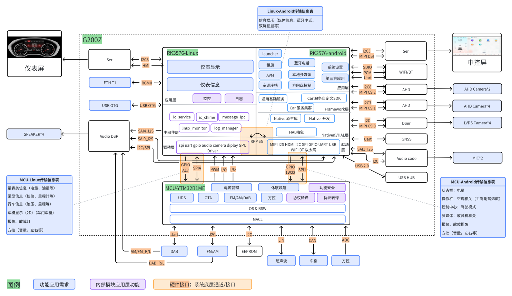

**图 1 G200Z系统框架**

**图 1 内容转写**（整理者据原图转写，非原文）

- **图例**：蓝色＝功能应用需求；紫色＝内部模块应用层功能；橙色＝硬件接口；系统底层通道/接口。
- **边界**：虚线框“G200Z”。框内：RK3576（左半“RK3576-Linux”、右半“RK3576-android”，两半之间为橙色“RPMSG”双向箭头）、“MCU-YTM32B1ME”，以及 Ser、ETH T1、USB OTG、Audio DSP、WIFI/BT、AHD、DSer、GNSS、Audio code、USB HUB 等器件。框外：仪表屏、中控屏、`SPEAKER*4`、`AHD Camera*2`、`AHD Camera*4`、`LVDS Camera*4`、`MIC*2`；MCU 下方的 DAB、FM/AM、EEPROM、超声波、车身、方控也画在虚线框之外。
- **RK3576-Linux（仪表）**
  - 应用层：仪表显示、仪表信息（蓝）；监控、日志（紫）
  - 中间件层：ic_service、ic_chime、message_ipc、linux_monitor、log_manager（紫）
  - 驱动层：spi uart gpio audio camera diplay GPU Driver（“diplay”为原图拼写）
- **RK3576-android（中控）**
  - 应用层：launcher、相册、AVM、空调座椅、蓝牙电话、本地多媒体、方向盘控制、系统设置、第三方应用
  - Framework层：通用基础服务、Car 服务自定义SDK、Car 服务集群
  - Native&VHAL层：Native 原生库、Native 开发、HAL抽象
  - 驱动层：MIPI I2S HDMI I2C SPI GPIO UART USB WIFI BT 以太网
- **RPMSG**：虚线引出“Linux-Android传输信息表”：信息娱乐（媒体信息、蓝牙电话、双屏互显等）
- **MCU-YTM32B1ME**：电源管理、休眠唤醒、功能安全（紫）；UDS、OTA、FM/AM/DAB、方控、协议转译（紫）、协议转译（紫）；OS & BSW；MACL（原图如此，即 MCAL）

SoC 与 MCU 之间的接口：

| 位置 | 接口（橙色标注） | 方向（按箭头） |
|---|---|---|
| Linux 一侧橙框（通道1） | GPIO A17 | Linux → MCU |
| Linux 一侧橙框（通道1） | SPI4 | 双向 |
| Linux 区域下方 | PWM、I/O、I/O | MCU → RK3576 |
| Android 一侧橙框（通道2） | GPIO 1W22 | Android → MCU |
| Android 一侧橙框（通道2） | SPI1 | 双向 |

- 通道1 橙框以虚线连至 **“MCU-Linux传输信息表”**：量表类信息（电量、油量等）；常显信息（档位、里程计等）；行车信息（胎压、里程等）；车模显示（2D）（车门车窗）；报警、故障灯；方控（音量，左右等）
- 通道2 橙框以虚线连至 **“MCU-Android传输信息表”**：状态栏：电量；操作栏：空调相关（主驾副驾温度）；控制中心：驾驶模式；多媒体：收音机相关；报警、故障提醒；方控（音量，左右等）

RK3576-Linux 的外设接口（图左侧）：

| 器件 | 接口 | 方向 | 外部设备 |
|---|---|---|---|
| Ser | I2C8、HMI | 双向 | Ser → 仪表屏 |
| ETH T1 | RGMII | 双向 | — |
| USB OTG | USB OTG | 双向 | — |
| Audio DSP | SAI4_I2S | Linux → Audio DSP | Audio DSP → `SPEAKER*4` |

RK3576-android 的外设接口（图右侧）：

| 器件 | 接口 | 方向 | 外部设备 |
|---|---|---|---|
| Ser | I2C3、MIPI DSI | 双向 | Ser → 中控屏 |
| WIFI/BT | SDIO、PCM、Uart | 双向 | — |
| AHD | I2C8、MIPI CSI2 | 双向 | AHD → `AHD Camera*2` |
| AHD | I2C7、MIPI CSI1 | 双向 | AHD → `AHD Camera*4` |
| DSer | I2C、MIPI CSI0 | 双向 | DSer → `LVDS Camera*4` |
| GNSS | Uart | 双向 | — |
| Audio code | SAI1_I2S、I2C | 双向 | Audio code → `MIC*2` |
| USB HUB | USB 2.0 | 双向 | — |
| Audio DSP（图左侧） | SAI0_I2S、I2C/SPI | 双向（连线沿 SoC 底部接入 android 区域） | — |

MCU 的外部接口（图下方）：

| 外部设备 | 接口 | 方向 |
|---|---|---|
| DAB | Uart | 双向 |
| FM/AM | I2C | 双向 |
| EEPROM | I2C | 双向 |
| 超声波 | LIN | 双向 |
| 车身 | CAN | 双向 |
| 方控 | ADC | 方控 → MCU |

- **模拟音频**：DAB、FM/AM 各有一路连线接入 Audio DSP；DAB 一路旁标注“AM/FM_R/L”，FM/AM 一路旁标注“DAB_R/L”（原图如此，标注疑似互换）。

上图中，蓝色色块对应功能应用需求，紫色模块表示系统内部的核心的应用层（系统软件视角）功能，橙色色块表示系统软件、硬件接口。

接口部分，本系统架构中共计3个功能通道。这个架构设计决定不同功能在不同子系统中的分布，每个功能通道传输的信息有不同，有相同。基于这种架构设计，可以获得以下收益：

- 两个系统软件解耦，产品功能上，两侧系统分属不同的功能安全等级，一侧出现故障、crash时，另一侧功能正常
- 硬件设计充裕，若后期存在变化，当前架构可以调整为“软件循环”式架构，若M与RK3576单通道，“软件循环”架构不可调整为本架构，开发灵活度高
- 减少MOS系统中核间通信负载，通过M侧分别传输两份，虽然信息量不大，考虑工程设计裕量后，仍然会占用不小的DDR内存，未来减少DDR内存成本时有更多空间。

通道1：L<->M方向，双向。SPI通信，MCU为master，linux为slave。GPIO，L侧向MCU侧发送触发信号，形成中断，实现双向主动通信。这一侧主要将来自车身CAN、VCU等等总线上的关联件的报文信息，提取、转译为L侧的消息中间件可接收的字段协议，并基于SPI封装发送。

通道2：A<->M方向，双向。SPI通信，MCU为master，安卓为slave。另有GPIO，A侧向M侧发送触发信号，形成中断，实现双向主动通信。

通道3：L<->M方向，双向。〔整理注：原文如此；按本段内容（RK3576 MOS 核间通信）及图1，应为 A<->L。〕基于RK3576的MOS系统的核间通信，基本也是异构芯片常见的“mailbox+共享内存”的机制，主要基于“rpmsg+共享内存”实现。

从MCU侧发送的信息角度看，绿色通道与蓝色通道合并同类项，有同一份数据，双向同时发送的部分。紫色模块为不同的子系统（如MCU、安卓系统）下不对外（用户）的、应用层功能。

### 3.2 总体软件架构

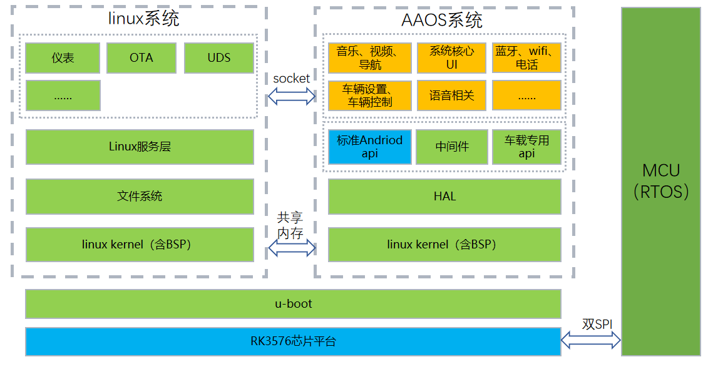

**图 2 RK平台系统软件架构**

**图 2 内容转写**（整理者据原图转写，非原文）

- 最底层：RK3576芯片平台；其上为 u-boot（横跨 linux系统与 AAOS系统两部分）。
- 右侧：MCU（RTOS）（纵向长条）；RK3576芯片平台 ↔ MCU 之间标注“双SPI”（双向箭头）。
- **linux系统**（自上而下）：应用（仪表、OTA、UDS、……）→ Linux服务层 → 文件系统 → linux kernel（含BSP）
- **AAOS系统**（自上而下）：应用（音乐、视频、导航；系统核心UI；蓝牙、wifi、电话；车辆设置、车辆控制；语音相关；……）→ 框架（标准Andriod api、中间件、车载专用api；“Andriod”为原图拼写）→ HAL → linux kernel（含BSP）
- 两系统之间：应用层之间为“socket”双向箭头；两个 linux kernel（含BSP）之间为“共享内存”双向箭头。

基于软硬件约束与设计原则，仪表侧选型Linux操作系统、中控侧选型安卓OS（AAOS）、MCU选择FreeRTOS操作系统；在各类操作系统基础之上，开发调试BSP（含文件系统）或MCAL，构成基础软件平台；在基础软件平台之上，仪表侧构成“应用层+服务层”的系统软件架构设计，中控侧利用AAOS原生软件架构，即“安卓NATIVE+安卓FRAMEWORK+安卓应用”的分层软件架构。

## 4 分模块软件架构及关键技术说明

### 4.1 底层多系统软件架构

在MOS硬隔离架构下，Linux仪表系统与AAOS中控系统在物理上相互隔离、独立运行，任一系统故障不影响对端正常运行，保证仪表显示的高可靠性与功能安全。本项目利用RK3576的MOS系统提供的“RPMSG+共享内存”方式、SOC与MCU之间的双SPI通道，构成跨系统软件架构。RK2576本身的异构跨核该链路（“A<->L”链路）为多操作系统间的核心链路。〔整理注：“RK2576”为原文笔误，应为 RK3576。〕

A-L之间MOS系统中的安卓到Linux操作系统之间的底层通信机制、业务逻辑。主要依靠MOS硬隔离的本身的核间通信完成，本质仍然是“RPMSG+共享内存”，基本的共享内存的内容如下图所示：

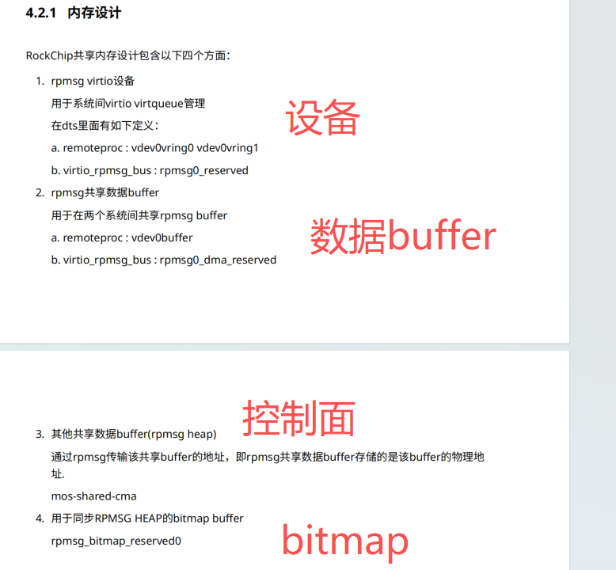

**图 3 RK平台MOS核间通信内存机制**

**图 3 内容转写**（原图为 RockChip 文档“4.2.1 内存设计”一节的截图，红色大字为标注；整理者转写，非原文）

- 截图标题：4.2.1 内存设计
- RockChip共享内存设计包含以下四个方面：
  1. rpmsg virtio设备（红色标注：**设备**）
     - 用于系统间virtio virtqueue管理
     - 在dts里面有如下定义：
       - a. remoteproc : vdev0vring0 vdev0vring1
       - b. virtio_rpmsg_bus : rpmsg0_reserved
  2. rpmsg共享数据buffer（红色标注：**数据buffer**）
     - 用于在两个系统间共享rpmsg buffer
       - a. remoteproc : vdev0buffer
       - b. virtio_rpmsg_bus : rpmsg0_dma_reserved
  3. 其他共享数据buffer(rpmsg heap)（红色标注 **控制面** 位于本项上方）
     - 通过rpmsg传输该共享buffer的地址，即rpmsg共享数据buffer存储的是该buffer的物理地址。
     - mos-shared-cma
  4. 用于同步RPMSG HEAP的bitmap buffer（红色标注：**bitmap**）
     - rpmsg_bitmap_reserved0

基于这个底层通信机制的典型应用，如下图所示：

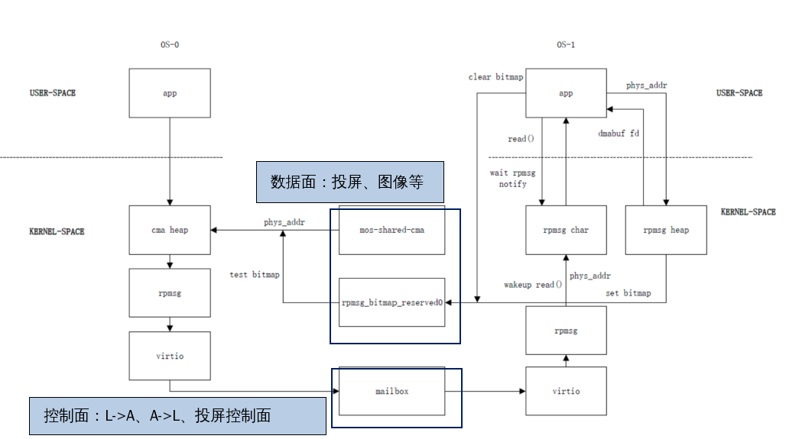

**图 4 “A-L”链路通信示例**

〔整理注：原文档在此图上叠加了一组浮动图形（“组合 16”：两个深蓝色线框和两个浅蓝色标签框），图片文件本身不含这些标注。上图为整理者按 docx 中的位置参数重绘的合成图；不含标注的原图见 [fig04_A-L-link-example.png](images/g200z-sw-arch/fig04_A-L-link-example.png)。〕

**图 4 内容转写**（整理者据原图转写，非原文）

- 布局：左为 OS-0，右为 OS-1；上部 USER-SPACE、下部 KERNEL-SPACE（虚线分隔）。〔整理注：图16 中 Linux 标为 OS0、Android 标为 OS1，可据此对应。〕
- OS-0：app → cma heap → rpmsg → virtio → mailbox
- 两系统之间的共享区：mos-shared-cma —(phys_addr)→ cma heap；rpmsg_bitmap_reserved0 —(test bitmap)→ 汇入通往 cma heap 的 phys_addr 连线
- OS-1：
  - mailbox → virtio → rpmsg —(wakeup read()、phys_addr)→ rpmsg char
  - app —(read()；wait rpmsg notify)→ rpmsg char；rpmsg char → app
  - app —(phys_addr)→ rpmsg heap；rpmsg heap —(dmabuf fd)→ app
  - rpmsg heap —(set bitmap)→ rpmsg_bitmap_reserved0；app —(clear bitmap)→ rpmsg_bitmap_reserved0
- 文档中的浮动标注：
  - 线框 1 框住 mos-shared-cma 与 rpmsg_bitmap_reserved0，标签“**数据面：投屏、图像等**”
  - 线框 2 框住 mailbox，标签“**控制面：L->A、A->L、投屏控制面**”

本项目中，A-L链路包含设计三个基于erpc的核间通信通道，用于linux与android系统之间的通信。

- LinuxMosCom ERPC client：用于 Android 主动发消息到 Linux；
- AndroidMosCom ERPC server：用于 Linux 主动发消息到 Android；
- 另外中控投屏仪表功能，基于第三个erpc通道发送投屏控制面信息。

### 4.2 MCU软件架构

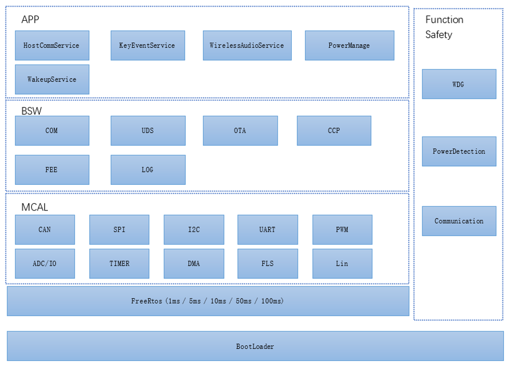

**图 5 MCU系统软件架构**

**图 5 内容转写**（整理者据原图转写，非原文）

| 层（自上而下） | 组成 |
|---|---|
| APP | HostCommService、KeyEventService、WirelessAudioService、PowerManage、WakeupService |
| BSW | COM、UDS、OTA、CCP、FEE、LOG |
| MCAL | CAN、SPI、I2C、UART、PWM、ADC/IO、TIMER、DMA、FLS、Lin |
| FreeRtos | FreeRtos (1ms / 5ms / 10ms / 50ms / 100ms) |
| BootLoader | BootLoader（最底层，横跨全宽） |
| Function Safety（右侧纵向，覆盖 APP 至 FreeRtos 各层） | WDG、PowerDetection、Communication |

本软件框架采用分层解耦设计，整体分为 6 大核心模块：Bootloader、FreeRTOS、MCAL、BSW、APP、Function Safety，各模块职责清晰、单向依赖，保障系统的可靠性与可维护性。

#### 4.2.1 Bootloader 启动与升级模块

系统最底层引导程序，负责 MCU 上电启动与固件升级流程管控。主要职责：

- 芯片初始化、时钟与基础外设配置；
- 固件完整性校验（CRC / 签名校验），防止非法固件运行；
- 支持 CAN 总线、主机下发的 OTA 升级流程，包含升级包接收、写入、擦除；
- 固件回滚保护：升级失败时自动恢复上一版本可用固件，保证系统可启动；
- 跳转至应用层（APP）程序执行，支持不同应用分区的切换。

#### 4.2.2 FreeRTOS 实时操作系统层

系统任务调度与资源管理核心，支撑上层所有业务模块的并发运行。主要职责：

- 多任务调度：支持不同优先级的周期 / 事件任务（1ms/5ms/10ms/50ms/100ms）；任务间通信：提供队列、信号量、互斥锁，实现模块间数据交互与资源互斥；
- 系统资源管理：任务栈分配、内存管理、定时器服务；
- 低功耗协同：配合休眠 / 唤醒逻辑，实现系统功耗管控。

#### 4.2.3 MCAL

硬件驱动层，封装芯片外设寄存器操作。本项目驱动内容项：

| 模块 | 功能 |
|---|---|
| CAN | CAN 总线收发、波特率配置、硬件滤波，为 BSW 通信模块提供底层支撑 |
| SPI | CAN芯片、功放芯片、主机等外设的通信驱动 |
| I2C | FA/AM芯片、EEPROM芯片的驱动 |
| UART | DAB芯片、Log记录的底层驱动 |
| PWM | 模拟输出 |
| ADC/IO | 按键扫描、电源电压检测、GPIO 输入输出控制 |
| TIMER | 系统计时、任务节拍、PWM/ADC 触发定时 |
| DMA | 高速数据搬运，降低 CPU 占用，提升通信 / 存储效率 |
| FLS | 片内 Flash 擦写操作，为 Bootloader/OTA/FEE 提供底层存储支持 |
| Lin | 雷达侧底层数据通讯驱动 |

〔整理注：I2C 行“FA/AM芯片”疑为“FM/AM芯片”（图1 中 MCU 经 I2C 连接 FM/AM）。〕

#### 4.2.4 BSW 基础软件层（中间件与协议栈）

介于 APP 与 MCAL 之间的标准化中间件层，提供车规级协议栈、系统服务，为应用层提供稳定的通用能力。

| 模块 | 核心功能 |
|---|---|
| COM 通信层 | CAN 信号的打包 / 解包、周期发送、信号有效性与滤波管理 |
| UDS 诊断服务 | 标准诊断协议（如 22/19/27/2E 服务）、故障码读取、标定写入 |
| OTA 升级管理 | 固件升级流程控制、升级状态管理、与 Bootloader 协同完成升级 |
| CCP 标定服务 | 研发阶段参数在线标定与调试，支持标定参数读写 |
| FEE（模拟 EEPROM） | 基于 Flash 实现掉电存储、用户配置、故障信息 |
| LOG 日志模块 | 系统运行日志、通信异常、故障信息记录，支持调试与售后分析 |

#### 4.2.5 APP 应用层（中控业务逻辑）

核心定位：中控 MCU 的业务逻辑实现层，不直接操作硬件，仅通过调用 BSW 服务完成功能。

| 模块 | 核心功能 |
|---|---|
| HostCommService 主机通信服务 | 与中控 SOC 主机双向交互，转发主机指令，上报按键、雷达、硬件等状态信息 |
| KeyEventService 按键事件服务 | 按键消抖、短按 / 长按 / 组合键解析，向上层上报标准化按键事件 |
| WirelessAudioService 无线音频服务 | 设备统一管理与路由、广播状态维护与同步、数据服务解析、异常监控与恢复 |
| PowerManage 电源管理应用 | 上下电时序、外设电源开关、过压 / 欠压保护、负载限流 |
| WakeupService 唤醒休眠应用 | 唤醒源检测（按键 / CAN / 主机）、低功耗模式控制、休眠唤醒流程管理 |

#### 4.2.6 Function Safety 功能安全模块

跨层级系统安全监控模块，为整个软件栈提供安全防护机制，满足车规级功能安全要求。

| 模块 | 核心功能 |
|---|---|
| WDG 看门狗监控 | 软件看门狗喂狗逻辑、任务超时监控，防止系统死锁 |
| PowerDetection 电源监控 | 电源电压实时监测、过压 / 欠压故障判定、安全保护逻辑 |
| Communication 通信监控 | CAN通信超时检测、通信异常处理 |
| 任务安全监控 | 任务执行时间监控、任务栈溢出检测、系统健康状态管理 |
| 安全模式控制 | 故障状态下的降级运行逻辑，如关闭非必要外设、进入安全状态 |

### 4.3 Linux(仪表)系统软件架构

仪表系统通过SPI总线与MCU进行高速双向通信，实时获取整车CAN网络中的车辆状态信号（车速、转速、油量/电量、水温、故障码、指示灯状态等）；同时通过RPMsg与AAOS中控系统进行跨域交互，接收中控下发的导航、多媒体、蓝牙电话、设置参数等，并向中控上报仪表状态数据。

仪表系统的核心功能包括：

1. 车辆状态实时采集与解析：通过SPI接收MCU上报的CAN报文，解析车速、转速、里程、油耗/电量、水温、胎压、档位、各类报警灯与指示灯状态等车辆核心数据。
2. 仪表UI渲染与显示：基于LVGL GUI引擎，在仪表屏上实时渲染车速表、转速表、燃油/电量表、水温表、里程信息、指示灯矩阵、报警弹窗、行车电脑信息等图形化界面。
3. 音效报警：通过扬声器驱动输出低油量报警音、超速报警音、车门未关提示音、安全带未系提示音、故障报警音等声音提示。
4. 日志管理：记录系统运行日志、通信异常日志与故障信息，支持分级存储与远程上报。

按照软件分层架构划分：

〔整理注：原文中以上 4 项与引导句、结尾句写在同一段内，此处拆成列表。〕

#### 4.3.1 底层系统方案

Linux系统架构如下：

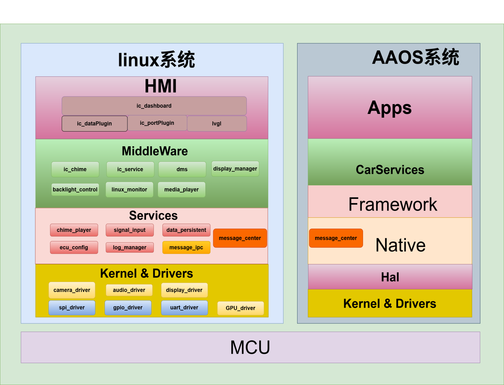

**图 6 仪表侧（Linux）系统软件架构**

**图 6 内容转写**（整理者据原图转写，非原文）

- 最底层：MCU（横跨 linux系统与 AAOS系统）
- **linux系统**（自上而下）：
  - HMI：ic_dashboard；其下 ic_dataPlugin、ic_portPlugin、lvgl
  - MiddleWare：ic_chime、ic_service、dms、display_manager、backlight_control、linux_monitor、media_player
  - Services：chime_player、signal_input、data_persistent、ecu_config、log_manager、message_ipc（黄色高亮）、message_center（橙色高亮）
  - Kernel & Drivers：camera_driver、audio_driver、display_driver、spi_driver、gpio_driver、uart_driver、GPU_driver
- **AAOS系统**（自上而下）：Apps、CarServices、Framework、Native（内含 message_center，橙色高亮）、Hal、Kernel & Drivers

Linux系统采用分层架构设计，整个系统自下而上分为硬件层、u-boot引导层、内核层、文件系统层、服务层和应用层。这种分层设计的核心理念是软硬件解耦与模块化。底层为上层提供基础支撑，上层通过标准化接口调用下层功能，使得各层可以独立演化。

各层分别进行说明：

**1.硬件层**

基于RK3576芯片平台，运行于ARM Cortex-A53处理器上，A53 属于高能效比的核心，常用于对功耗敏感但对智能化有一定要求的场景。

**2.u-boot**

u-boot是一个开源的引导加载程序（Bootloader），位于硬件层之上。它是操作系统启动的必经之路，是连接硬件与操作系统的“桥梁”。

主要作用：

- 硬件初始化：在系统上电后，初始化 CPU、内存（DDR）、串口等最基础的硬件环境。
- 加载内核：从存储介质（如 Flash 或 eMMC）中读取 Linux 内核镜像和设备树文件，加载到内存中。
- 移交控制权：向内核传递启动参数（bootargs），并将系统控制权移交给 Linux 内核。

〔整理注：原文以上 3 项写在同一段内，此处拆成列表。〕

**3.内核**

内核层Linux 操作系统的核心，直接运行在硬件之上，管理系统资源（进程、内存），与各个外设硬件对接，为上层提供访问硬件的统一接口（系统调用）。

包含模块及说明：

- SPI驱动：负责通过总线与MCU进行高速通信。
- 仪表屏驱动：针对仪表屏编写的驱动，负责图像数据的输出和屏幕点亮。
- 扬声器驱动：音频编解码器（Codec）或 PWM 驱动，负责音频信号的放大和播放。
- GPIO驱动：通用输入输出驱动，用于控制芯片引脚的高低电平，实现 LED 灯控、按键检测等基础硬件交互。

**4.文件系统**

文件系统存放系统运行所需程序、库文件和数据的组织结构。

#### 4.3.2 服务层（通信服务及IPC）方案

服务层及中间件层为开发重点。

系统内 IPC 层：message_ipc service 实现消息路由与分发,message_ipc client封装本地通信接口，为上层服务提供统一的消息收发能力。 所有座舱进程（车控、UI、媒体、诊断、外设服务等）不再直接点对点通信，而是统一接入本服务：进程可订阅指定主题（Topic） 接收消息，也可向指定主题发布消息实现数据广播 / 指令下发。服务封装底层 Linux IPC 细节，提供标准化调用接口，满足座舱多进程、高可靠、低延迟、解耦合的通信需求。 本方案为车载智能座舱系统设计了一套基于MQTT 协议（Mosquitto Broker）的进程间通信（IPC）架构，采用发布 - 订阅模式，实现座舱内各模块的解耦通信，满足车载场景对实时性、可靠性和可扩展性的需求。

(1) Message IPC架构图

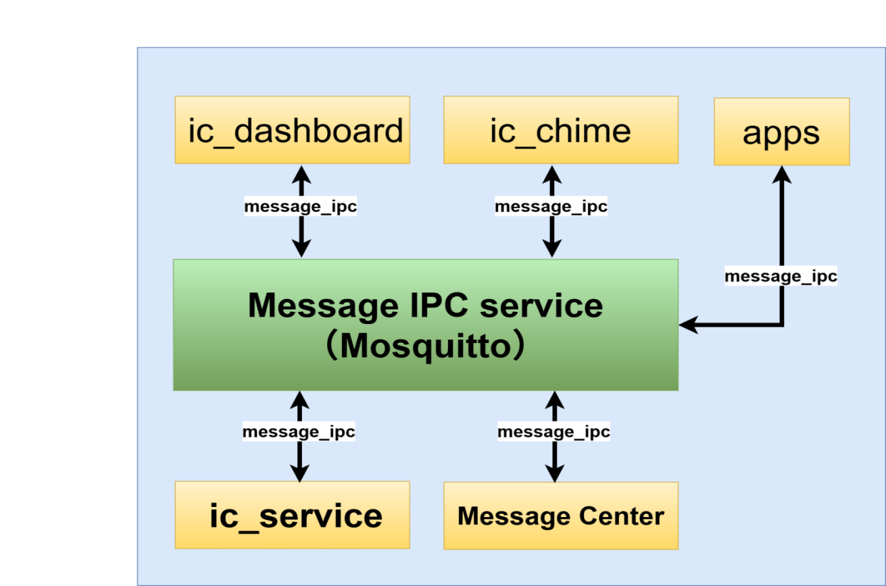

**图 7 仪表系统服务层架构**

**图 7 内容转写**（整理者据原图转写，非原文）

- 中心：Message IPC service（Mosquitto）
- ic_dashboard、ic_chime、apps、ic_service、Message Center 均以 message_ipc（双向箭头）与 Message IPC service 相连。

以Mosquitto（Message IPC service）为消息中枢，所有业务模块通过message_ipc客户端接入，实现消息的发布与订阅，典型模块包括：

交互层：ic_dashboard（仪表显示）、ic_chime（音效提示）、apps（车载应用） instru cluster

服务层：ic_service（座舱核心服务）、Message Center（消息转发中心）

| 特性 | 说明 | 车载场景价值 |
|---|---|---|
| 轻量级 | 单进程事件驱动架构，代码量 < 10 万行，资源占用极低 | 适配车载嵌入式平台的算力限制 |
| 低延迟 | 单线程 I/O 多路复用模型，消息转发微秒级延迟 | 满足座舱交互实时性要求 |
| 高可靠 | 支持 MQTT QoS 0/1/2 消息质量等级，保障关键指令不丢失 | 适配车载场景的安全与可靠性需求 |
| 解耦性 | 发布 - 订阅模式，模块间无直接依赖 | 降低座舱系统复杂度，便于功能迭代 |
| 跨平台 | 支持 Linux/Android 等车载主流系统，提供 C/C++/Java 客户端库 | 兼容座舱异构平台 |

性能要求

| 指标类别 | 指标项 | 车载场景量化要求 | 说明 |
|---|---|---|---|
| 基础资源占用 | CPU 占用率 | 单核心峰值 ≤ 5%，稳态 ≤ 1% | 以 4 核 A53 1.2GHz 平台为基准，避免抢占业务线程资源 |
| 基础资源占用 | 内存占用 | 稳态内存 ≤ 10MB，峰值内存 ≤ 30MB | 含 Broker 进程 + 客户端库，避免 OOM（内存溢出）风险 |
| 基础资源占用 | 磁盘占用 | Broker 二进制文件 ≤ 500KB，运行日志 ≤ 100MB / 天 | 适配车机 eMMC 存储限制，避免日志膨胀 |
| 消息处理性能 | 消息转发延迟 | 平均 ≤ 10ms，P99 ≤ 50ms | 端到端延迟（发布者→Broker→订阅者），满足座舱交互实时性 |
| 消息处理性能 | 消息吞吐量 | 支持≥1000 条 / 秒稳定转发，峰值≥5000 条 / 秒 | 覆盖仪表、服务、消息中心等多模块高频通信场景 |
| 消息处理性能 | 消息丢失率 | 关键消息（QoS1/2）丢失率 = 0，普通消息（QoS0）丢失率≤0.01% | 关键指令（如安全提示、音效）零丢失，状态数据允许极低丢包 |
| 并发与稳定性 | 客户端连接数 | 支持≥32 个客户端稳定连接 | 覆盖当前 ic_dashboard、ic_chime、apps、ic_service、Message Center 及扩展模块 |
| 并发与稳定性 | 会话重连成功率 | 客户端断连后重连成功率≥99.99%，重连时间≤500ms | 适配车机休眠 / 唤醒、网络波动场景 |
| 并发与稳定性 | Broker 可用性 | 连续运行 7×24 小时无崩溃、无僵死 | 需配合进程守护（如 systemd）实现异常自动重启 |
| 可靠性指标 | 消息持久化成功率 | 离线消息缓存成功率 = 100%，补发成功率≥99.99% | 客户端离线期间发布的消息，重连后可完整补发 |
| 可靠性指标 | 异常恢复时间 | Broker 进程崩溃后，重启 + 恢复服务≤2s | 含进程拉起、客户端重连、会话恢复全流程 |

〔整理注：原表“指标类别”只在每组首行填写，此处每行补全，便于按行检索。〕

核间通信服务层：message_center提供跨系统调用能力,通过RPMsg实现与 AAOS 的跨系统物理通道。本服务是部署在智能座舱 Linux 系统下的中心化进程间通信中间件，以发布（Publish）- 订阅（Subscribe） 为核心模型，统一接管系统内所有业务进程的消息交互。在智能座舱中，Android 和 Linux 之间需要进行大量的数据交换，故封装设计 Message Center Service 作为 Android 与 Linux 之间通信的基础服务。

Message Center Service 应满足以下设计目标：

- 在 Linux 和 Android 之间传递数据
- 底层使用基于共享内存的 RPMsg 进行通信
- 基于 Topic 的消息分发，消息内容 格式 由双方 客户端 协商决定
- 尽量最大可能把消息发送到接收方，但并不保证消息一定会发送到。
  如果应用消息一定要确保发送，需要自己在应用层协议设计 ACK 机制。

#### 4.3.3 应用层

本项目显示应用基于 LVGL 图形系统开发，为车载仪表提供人机交互（HMI）界面，实现车辆信息可视化与交互控制。仪表显示应用作为车载 HMI 的核心模块，负责将车辆运行状态、驾驶信息、交互提示等数据以图形化方式呈现给驾驶员。

架构采用分层模块化架构，自下而上分为三层：

- 底层适配层（ic_portPlugin）：负责 LVGL 与硬件平台的对接，包括显示驱动适配、输入设备适配、系统时钟 / 定时器适配，实现硬件无关性封装。
- 图形渲染层（lvgl）： 基于 LVGL v9.x 稳定版本构建图形引擎，配置轻量级渲染模式，优化控件与动画性能，管理界面资源（字体、图标、图片）。
- 业务逻辑层（ic_dataPlugin）：实现仪表业务逻辑，与车辆数据中间件模块ic_service交互模块对接，驱动 LVGL 界面更新，处理场景调度与交互逻辑。
- UI功能层（ic_dashboard）：实现仪表UI业务逻辑显示。

（1）UI软件架构图

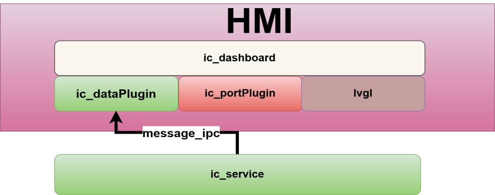

**图 8 应用显示软件架构**

**图 8 内容转写**（整理者据原图转写，非原文）

- HMI：上层 ic_dashboard；下层 ic_dataPlugin、ic_portPlugin、lvgl
- ic_service —(message_ipc)→ ic_dataPlugin

性能要求方面，一般的设计原则关注：渲染性能，包括帧率、刷新延迟、局部刷新；资源占用，包括内存占用、Flash 占用、CPU 占用；稳定性与可靠性，包括长期运行稳定性：异常处理、环境适应性。

### 4.4 安卓应用软件架构

安卓应用层直接面向用户机车载业务。主要业务功能包含模块及说明：

- 第三方应用：如音乐、视频、导航等，通常由外部开发者提供，丰富了车机的功能生态。
- 系统核心UI：包括 Launcher（桌面启动器）和 SystemUI（系统状态栏、虚拟按键等），是用户看到的第一界面，决定了系统的整体视觉风格和操作逻辑。
- 其他基础应用：蓝牙、WiFi、电话等，提供基础的设备连接和通讯功能。
- 车辆特性相关：车辆设置、车辆控制等，客户（OEM）定制专属功能。语音相关：集成语音识别和合成引擎，提供语音助手功能，提升驾驶过程中的操作安全性。
- 应用组件：图中额外列出了 common（公共库）、基础UI、基础工具、can信号通讯、中间件通讯、应用间通讯等组件。这些是支撑上述应用运行的底层模块，例如 CAN 信号通讯是车载系统获取车辆数据的核心通道，应用间通讯则保障了不同软件之间的数据交换和协同工作。

现代安卓应用开发

〔整理注：本节原文没有配图，“图中”所指的图缺失；“现代安卓应用开发”在原文中为一行孤立文字。〕

### 4.5 安卓FRAMEWORK软件架构

安卓FWK层软件架构处于安卓应用层之下，NATIVE C/C++之上，应用框架支持层是Android 系统的核心框架层，提供了开发 Android 应用所需的各种服务和 API。为上层应用提供系统级的支持，管理应用的运行生命周期，并作为应用与底层硬件通信的枢纽。

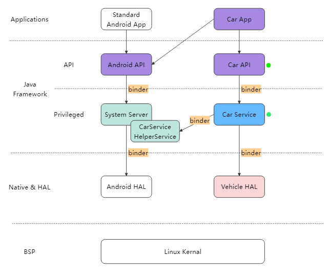

**图 9 安卓FrameWork框架**

**图 9 内容转写**（整理者据原图转写，非原文）

| 层 | 标准 Android 路径 | 车载路径 |
|---|---|---|
| Applications | Standard Android App | Car App |
| API（Java Framework） | Android API | Car API（旁有绿色圆点） |
| Privileged（Java Framework） | System Server（右下叠放 CarService HelperService） | Car Service（旁有绿色圆点） |
| Native & HAL | Android HAL | Vehicle HAL |
| BSP | Linux Kernal（原图拼写，横跨两列） | 同左 |

- 连线：Standard Android App → Android API；Car App → Android API；Car App → Car API
- Android API —binder→ System Server —binder→ Android HAL
- Car API —binder→ Car Service —binder→ Vehicle HAL；Car Service —binder→ CarService HelperService

框架如上图所示，本文重点关注的是Car API 和 Car Service的设计，

包含模块：

- 标准Android api：提供 Android 原生的基础功能，如界面绘制、网络通信、数据存储等，保障系统的通用性。
- 中间件：这里指的是 Android 系统中的各种系统服务（如 WindowManager、ActivityManager 等），负责协调系统内各个部分的工作。
- 系统服务：提供更底层的系统功能支持，如电源管理、闹钟服务等。
- 车载专用API：本项目开发为智能座舱的车载SDK接口平台。提供针对汽车场景的特殊接口，为车载主机厂客户提供。

#### 4.5.1 Car API 和Service架构设计

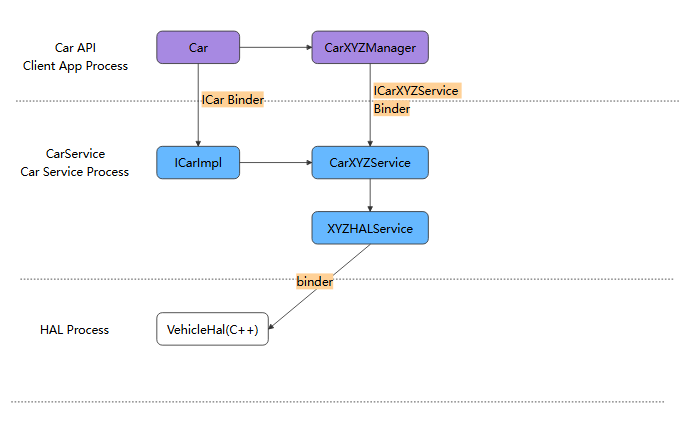

**图 10 安卓FWK-Service架构**

**图 10 内容转写**（整理者据原图转写，非原文）

- Car API / Client App Process：Car → CarXYZManager
- CarService / Car Service Process：ICarImpl → CarXYZService → XYZHALService
- HAL Process：VehicleHal(C++)
- 跨进程：Car —(ICar Binder)→ ICarImpl；CarXYZManager —(ICarXYZService Binder)→ CarXYZService；XYZHALService —(binder)→ VehicleHal(C++)

AAOS系统已对部分车辆功能做了标准化处理，主要载体是各种CarXYZService（详见附录一）。这些CarXYZService向上映射成CarAPI（即各种CarXYZManager）供App调用，向下与HAL通讯。具体工作流：

1. 任何 App 可以创建 Car 对象，通过 Car 对象获取不同的 Manager（如，CarPropertyManager、CarPowerManager等）；
2. ICarImpl负责维护所有的Service对象，每个Service都不是独立进程，是运行在Car Service进程内的独立对象。Android 14中的Service列表，详见附录一；
3. 每个 CarXYZManager 都通过 binder 连接到 CarXYZService.java，例如：CarPropertyManager 通过 ICarProperty.aidl 连接到 CarPropertyService.java；
4. CarXYZService通过XYZHalService与底层VehicleHal通讯；
5. App监听车辆状态，采用的是注册回调的方式，注册回调后底层数据更新，可直接回调给上层接收器；

〔整理注：原文档未包含“附录一”。〕

#### 4.5.2 Car API 的示例

```java
public class HVACActivity extends Activity {
    @Override
    protected void onCreate(Bundle savedInstanceState) {
        super.onCreate(savedInstanceState);
        setContentView(R.layout.activity_main);
        // 1、采用Car API 创建Car对象
        mCar = Car.createCar(this, null, Car.CAR_WAIT_TIMEOUT_DO_NOT_WAIT, new Car.CarServiceLifecycleListener(){
            @Override
            public void onLifecycleChanged(Car car, boolean ready) {
                if (!ready) return;
                // 2、获取 CarXYZManager
                mCarPropertyManager = (CarPropertyManager) car.getCarManager(Car.PROPERTY_SERVICE);
                // 3、注册监听回调。第1个参数为回调接口；第2个参数决定了，只回调当前空调温度；第3个参数决定了回调速率；
                boolean registerCallbackResult = mCarPropertyManager.registerCallback(mHvacCallback, VehiclePropertyIds.HVAC_TEMPERATURE_CURRENT, CarPropertyManager.SENSOR_RATE_ONCHANGE);
                Log.d(TAG, "注册 温度变更监听回调 结果: " + registerCallbackResult);
            }
        });
    }
    @Override
    protected void onDestroy() {
        super.onDestroy();
        // 注销监听
        if (mCarPropertyManager != null) {
            mCarPropertyManager.unregisterCallback(mHvacCallback);
        }
    }
}
```

#### 4.5.3 调用流程图

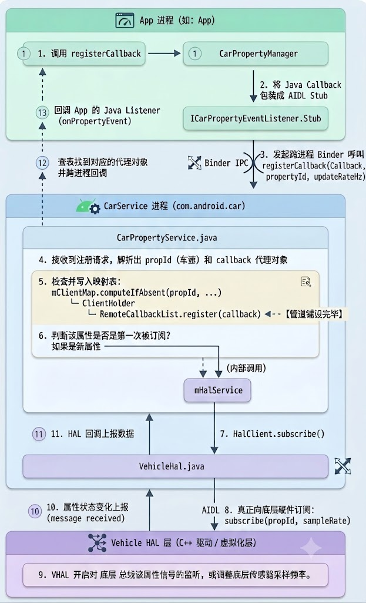

**图 11 FWK层与上下层之间调用流程**

**图 11 内容转写**（整理者据原图转写，非原文；圆圈数字为图中步骤编号，实线为订阅下行，虚线为回调上行）

- **App 进程（如：App）**
  - ① 1. 调用 registerCallback → ① CarPropertyManager
  - CarPropertyManager —(2. 将 Java Callback 包装成 AIDL Stub)→ ICarPropertyEventListener.Stub
  - ⑬ 回调 App 的 Java Listener (onPropertyEvent)（虚线箭头回到“1. 调用 registerCallback”）
- **Binder IPC**：3. 发起跨进程 Binder 呼叫 registerCallback(Callback, propertyId, updateRateHz)（ICarPropertyEventListener.Stub → CarService 进程）；⑫ 查表找到对应的代理对象并跨进程回调（虚线，CarService 进程 → App 进程）
- **CarService 进程（com.android.car）**
  - CarPropertyService.java：
    - 4. 接收到注册请求，解析出 propId (车速) 和 callback 代理对象
    - 5. 检查并写入映射表：`mClientMap.computeIfAbsent(propId, ...)` └ `ClientHolder` └ `RemoteCallbackList.register(callback)` ◄-- 【管道铺设完毕】
    - 6. 判断该属性是否是第一次被订阅？如果是新属性 —(内部调用)→ mHalService
  - mHalService —(7. HalClient.subscribe())→ VehicleHal.java
  - ⑪ 11. HAL 回调上报数据（VehicleHal.java → CarPropertyService.java）
- **VehicleHal.java → Vehicle HAL 层**：AIDL 8. 真正向底层硬件订阅：subscribe(propId, sampleRate)
- **Vehicle HAL 层（C++ 驱动 / 虚拟化层）**：9. VHAL 开启对 底层 总线该属性信号的监听，或调整底层传感器采样频率。
- ⑩ 10. 属性状态变化上报 (message received)（Vehicle HAL 层 → VehicleHal.java）

##### 4.5.3.1 订阅请求与跨进程管道

这一阶段的核心目的是：App 发起订阅请求，并在 CarService 内部建立好映射表，确保底层有数据时能顺着管道准确回调给正确的 App。

**1、App 进程内部发起**

【**步骤 1**】调用 registerCallback。

App（例如仪表盘或设置应用）通过调用 AAOS 开放的 SDK 接口 CarPropertyManager.registerCallback()，表达对某个特定属性（如车速 PERF_VEHICLE_SPEED）的监听意图。

【**步骤 2**】将 Java Callback 包装成 AIDL Stub。

App 传入的是一个纯 Java 层的 Callback 对象。由于 App 和 CarService 属于不同的进程，Java 对象无法直接跨进程传递。因此，CarPropertyManager 会在内部创建一个 AIDL 接口的本地实现类对象（即 ICarPropertyEventListener.Stub），将你的 Java Callback 包裹在里面。这个 Stub 就是后续 Binder 通信的基石。

【**步骤 3**】发起跨进程 Binder 呼叫 registerCallback(Callback, propertyId, updateRateHz)。

App 进程通过 Binder IPC 机制，远程调用 CarService 进程中 CarPropertyService 提供的 registerCallback 方法，并将包裹好的 Stub 代理对象、目标属性 ID 以及期望的刷新频率（Hz）传递过去。

**2、CarService 进程内部流转（Java 层核心）**

【**步骤 4**】接收到注册请求，解析出 propId (车速) 和 callback 代理对象。

运行在 com.android.car 进程中的 CarPropertyService.java 响应了 Binder 请求。它从 Binder 驱动中反序列化出客户端传来的参数，拿到了 propId 和代表客户端的 callback 远程代理对象（Proxy）。

【**步骤 5**】检查并写入映射表

这是铺设回调管道的关键。CarPropertyService 内部维护着多端映射关系（mClientMap）。它会为每个 App 客户端创建或查找对应的 ClientHolder，并调用RemoteCallbackList.register(callback)。RemoteCallbackList 是 Android 系统专门用来管理跨进程回调的利器，它不仅能安全地管理多个客户端回调，还能在 App 意外崩溃时自动释放注册，防止 CarService 发生内存泄漏。到这一步，从 CarService 回调到 App 的管道彻底铺设完毕。

【**步骤 6**】判断该属性是否是第一次被订阅？

策略优化。如果其他 App 之前已经订阅过车速，且当前请求的频率没有超过现有频率，CarService 内部直接复用即可，无需再惊动底层。如果是全新属性或者请求了更高的采样率，则判定为“新属性”，继续向下调用内部组件 mHalService。

【**步骤 7**】HalClient.subscribe()

mHalService 是 CarService 内部专门对接 HAL 层的管家。它调用 HalClient.subscribe()，开始准备将订阅请求送出 Java 世界。

**3、跨越 Java/C++ 边界与硬件订阅**

【**步骤 8**】真正向底层硬件订阅：subscribe(propId, sampleRate)

VehicleHal.java 负责将 Java 层的业务请求转化为底层需要的标准。在 Android 14 中，Java 层的 VehicleHal 会通过标准的 AIDL 跨进程通信（此时跨越了 Java 空间进入到 C++ 的原生系统守护进程空间），调用 C++ VHAL 层的 subscribe(propId, sampleRate) 方法。

【**步骤 9**】VHAL 开启对底层总线该属性信号的监听

C++ 层的 Vehicle HAL 接收到指令后，直接与车载网络（如车载以太网、CAN 总线适配芯片驱动等）或虚拟化层对接。它会指示硬件或驱动层：“开始监听这个信号”，或者“将该传感器的采样频率调整为对应的参数”。至此，下发订阅流程全线打通。

##### 4.5.3.2 数据状态上报与多级回调

当车辆行驶、数据发生变化时，数据开始沿原路（但走回调通道）反向传输。

【**步骤 10**】属性状态变化上报 (message received)

车辆实际车速发生变化，底层车载网络（物理总线或模拟器）发出数据报文。C++ 层的 Vehicle HAL 接收到消息 (message received)，将其解析为 Android 定义的 VehiclePropValue 结构体。

【**步骤 11**】HAL 回调上报数据

C++ VHAL 通过之前初始化时注册的 AIDL Callback 接口，将数据往上传递给 Java 层的 VehicleHal.java。

架构细节：由于 VehicleHal.java 和 mHalService 同属于 com.android.car 进程，因此从 VehicleHal.java 向上递交给 mHalService 的过程是纯粹的同进程内 Java 方法回调，不需要跨进程，也没有 AIDL 损耗，非常高效。

【**步骤 12**】查表找到对应的代理对象并跨进程回调

数据传回 CarPropertyService。它以收到的 propId 为 Key，去查步骤 5 建立的那张映射表（mClientMap / RemoteCallbackList）。它会遍历所有订阅了该属性的 App 客户端代理对象（Proxy），然后通过 Binder IPC 将数据跨进程广播出去。

【**步骤 13**】回调 App 的 Java Callback (onPropertyEvent)

App 进程里的 Binder 线程收到了 CarService 传过来的属性数据。经过 ICarPropertyEventListener.Stub 的解析后，无缝切换回 App 的主线程或指定线程，最终调用 App 开发者实现的 Java Callback 对象的 onPropertyEvent() 方法。

此时，App 成功拿到最新的数据，刷新 HMI 界面。

#### 4.5.4 架构扩展

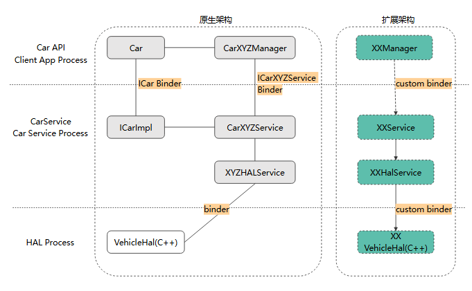

**图 12 原生基础上扩展SDK架构**

**图 12 内容转写**（整理者据原图转写，非原文）

- 行（进程）：Car API / Client App Process；CarService / Car Service Process；HAL Process
- **原生架构**（左侧虚线框，同图10）：Car — CarXYZManager；Car —(ICar Binder)— ICarImpl；CarXYZManager —(ICarXYZService Binder)— CarXYZService；ICarImpl — CarXYZService — XYZHALService —(binder)— VehicleHal(C++)
- **扩展架构**（右侧虚线框，绿色虚线框组件）：XXManager —(custom binder)→ XXService → XXHalService —(custom binder)→ XX VehicleHal(C++)

在实际功能开发过程中，原生系统尚未支持的属性、场景和功能，还需要修改某个模块或者横向扩展整个架构。如在实际量产开发中，VehiclePropertyIds的属性，不能覆盖实际业务场景时，就需对其属性进行扩展。扩展可遵顼如下架构：

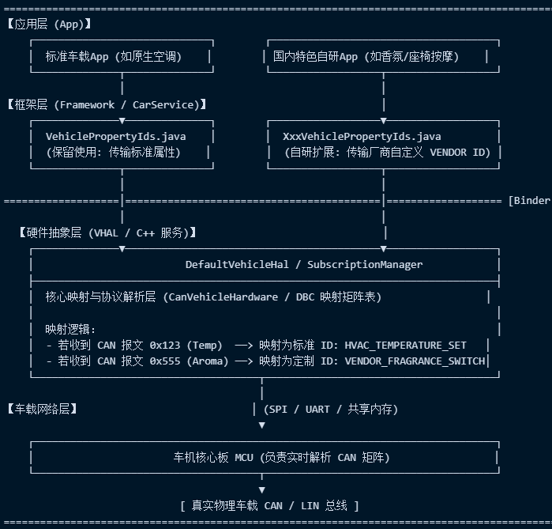

**图 13 分层后架构示意图**

**图 13 内容转写**（原图为字符画风格；整理者转写，非原文）

| 层 | 标准路径 | 自研扩展路径 |
|---|---|---|
| 【应用层 (App)】 | 标准车载App (如原生空调) | 国内特色自研App (如香氛/座椅按摩) |
| 【框架层 (Framework / CarService)】 | VehiclePropertyIds.java (保留使用: 传输标准属性) | XxxVehiclePropertyIds.java (自研扩展: 传输厂商自定义 VENDOR ID) |
| 分隔线 “[Binder…”（原图右侧截断） | ↓ | ↓ |
| 【硬件抽象层 (VHAL / C++ 服务)】 | DefaultVehicleHal / SubscriptionManager（两路在此汇合） | 同左 |

- 【硬件抽象层 (VHAL / C++ 服务)】内部：核心映射与协议解析层 (CanVehicleHardware / DBC 映射矩阵表)
  - 映射逻辑：
    - 若收到 CAN 报文 0x123 (Temp)  —> 映射为标准 ID: HVAC_TEMPERATURE_SET
    - 若收到 CAN 报文 0x555 (Aroma) —> 映射为定制 ID: VENDOR_FRAGRANCE_SWITCH
- 【车载网络层】：VHAL —(SPI / UART / 共享内存)→ 车机核心板 MCU (负责实时解析 CAN 矩阵) → [ 真实物理车载 CAN / LIN 总线 ]

### 4.6 安卓NATIVE软件架构

硬件抽象层位于内核与应用框架之间的中间层，通常以动态链接库（.so 文件）的形式存在。将内核提供的底层硬件驱动接口进行标准化封装。它为上层框架提供统一的接口，屏蔽不同芯片平台（如 RK3576J）底层驱动的差异，是实现软硬件解耦的一层。

#### 4.6.1 NATIVE 软件架构

本层在座舱业务中，开发工作量较多，需要和仪表侧、MCU、安卓上层对接，属于枢纽功能，Native层软件架构如下图所示：

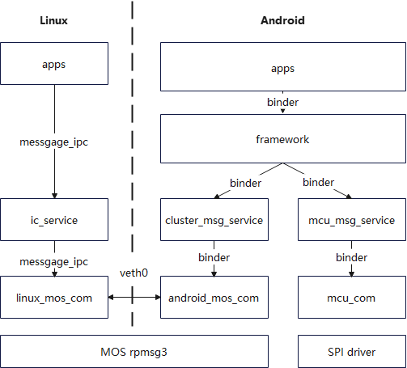

**图 14 Native层架构**

**图 14 内容转写**（整理者据原图转写，非原文）

- **Linux**：apps —(messgage_ipc)→ ic_service —(messgage_ipc)→ linux_mos_com（“messgage_ipc”为原图拼写）
- **Android**：apps —(binder)→ framework；framework —(binder)→ cluster_msg_service —(binder)→ android_mos_com；framework —(binder)→ mcu_msg_service —(binder)→ mcu_com
- **跨系统**：linux_mos_com ⇄(veth0)⇄ android_mos_com（跨越 Linux / Android 分界虚线）
- **底层**：MOS rpmsg3（位于 linux_mos_com 与 android_mos_com 之下）；SPI driver（位于 mcu_com 之下）

如上图所示，androi_mos_com mcu_com，cluster_msg_service,mcu_msg_service服务层，这些服务基于VHAL内部处理消息收发和转译。模块与模块之间通过安卓原生中间件服务binder，构成Native层软件架构。北向接口，native与安卓FWK层通过binder机制交互业务信息，南向接口，与MCU通过SPI通信构成消息交互通道；横向跨核通信，则实现中控与仪表通信机制。

#### 4.6.2 “A<->L”中控侧和仪表通信机制设计

本次服务关系如下图所示：

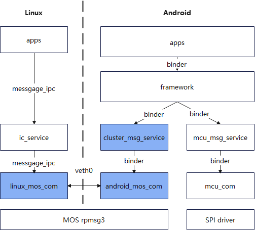

**图 15 与仪表核间通信架构示意**

**图 15 内容转写**（整理者据原图转写，非原文）

- 结构与图14 相同；以蓝色高亮 A<->L 相关组件：cluster_msg_service、android_mos_com、linux_mos_com。

Android 与 Linux 两侧使用 **双 TCP 通道 + 双 ERPC 角色**。Android 侧同时具备：

- LinuxMosCom ERPC client：用于 Android 主动发消息到 Linux。
- AndroidMosCom ERPC server：用于 Linux 主动发消息到 Android。
- Binder AIDL HAL：用于 Android 侧本地调用者访问 MOS COM。

adnroid_mos_com的软件架构如下：

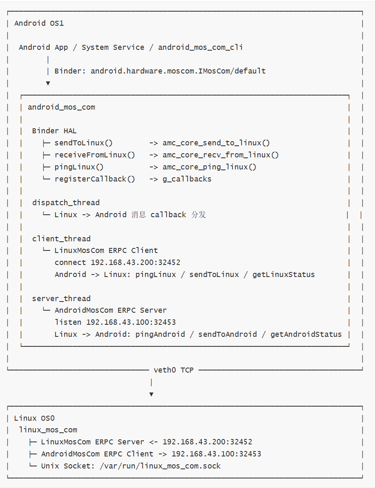

**图 16 adnroid_mos_com服务软件架构**

**图 16 内容转写**（原图为字符画，以下按原图文字转写，省略右侧边框；非原文）

```text
┌ Android OS1
│
│  Android App / System Service / android_mos_com_cli
│        │
│        │ Binder: android.hardware.moscom.IMosCom/default
│        ▼
│  ┌ android_mos_com
│  │
│  │  Binder HAL
│  │    ├─ sendToLinux()        -> amc_core_send_to_linux()
│  │    ├─ receiveFromLinux()   -> amc_core_recv_from_linux()
│  │    ├─ pingLinux()          -> amc_core_ping_linux()
│  │    └─ registerCallback()   -> g_callbacks
│  │
│  │  dispatch_thread
│  │    └─ Linux -> Android 消息 callback 分发
│  │
│  │  client_thread
│  │    └─ LinuxMosCom ERPC Client
│  │       connect 192.168.43.200:32452
│  │       Android -> Linux: pingLinux / sendToLinux / getLinuxStatus
│  │
│  │  server_thread
│  │    └─ AndroidMosCom ERPC Server
│  │       listen 192.168.43.100:32453
│  │       Linux -> Android: pingAndroid / sendToAndroid / getAndroidStatus
│  └
└──────────────────────── veth0 TCP ────────────────────────
                              │
                              ▼
┌ Linux OS0
│  linux_mos_com
│    ├─ LinuxMosCom ERPC Server <- 192.168.43.200:32452
│    ├─ AndroidMosCom ERPC Client -> 192.168.43.100:32453
│    └─ Unix Socket: /var/run/linux_mos_com.sock
└
```

#### 4.6.3 “M<->A”链路机制方案

该链路主要接收来自MCU控制芯片信息，MCU在座舱域控中对来自车身的信息、设置、控制信号进行接口接入、协议解析，再通过SPI接口和安卓、linux对接。Native一侧，即通过VHAL接入SPI驱动，再在此基础上通过systemserver，与安卓侧FWK接入。示意图如下：

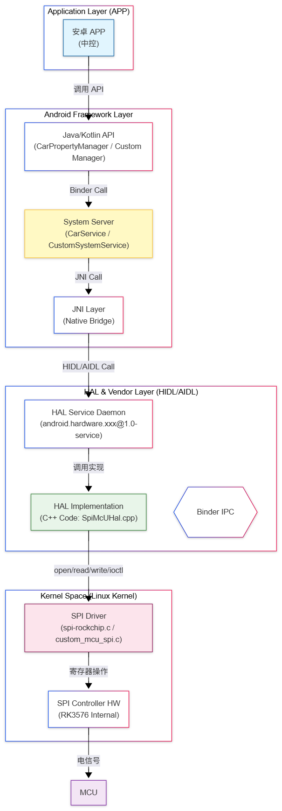

**图 17 M-A通道流程图**

**图 17 内容转写**（整理者据原图转写，非原文）

```text
[Application Layer (APP)]
  安卓 APP (中控)
      │ 调用 API
      ▼
[Android Framework Layer]
  Java/Kotlin API (CarPropertyManager / Custom Manager)
      │ Binder Call
      ▼
  System Server (CarService / CustomSystemService)
      │ JNI Call
      ▼
  JNI Layer (Native Bridge)
      │ HIDL/AIDL Call
      ▼
[HAL & Vendor Layer (HIDL/AIDL)]        （层内另有一个六边形标注：Binder IPC）
  HAL Service Daemon (android.hardware.xxx@1.0-service)
      │ 调用实现
      ▼
  HAL Implementation (C++ Code: SpiMcUHal.cpp)
      │ open/read/write/ioctl
      ▼
[Kernel Space (Linux Kernel)]
  SPI Driver (spi-rockchip.c / custom_mcu_spi.c)
      │ 寄存器操作
      ▼
  SPI Controller HW (RK3576 Internal)
      │ 电信号
      ▼
MCU
```

这个链路为双向链路，分为上行（MCU -> APP）和下行（APP -> MCU）两条路径来解析代码层面的交互。其中上行链路：MCU数据上报至 APP (Read/Event)，MCU通过SPI发送数据包（例如：车速、温度、按键状态）。驱动将数据解析并存入内核内存。HAL服务(SpiMcUHal.cpp) 运行在一个独立的守护进程中。轮询模式：HAL 开启一个线程，定期通过 ioctl() 或 read() 从 SPI 驱动节点 (/dev/spidevX.X) 读取数据。中断/回调模式：如果驱动支持 poll() 或异步通知，HAL 等待驱动通知有新数据。HAL 将原始 SPI 数据解析为结构化数据（如 VehiclePropValue）。Binder IPC:HAL 调用 mCallback->onPropertyEvent() (如果是 VHAL) 或自定义 AIDL/HIDL 接口的回调方法。数据通过 Binder 机制跨进程传输到 System Server。

CarService 或自定义 System Service 接收 Binder 回调。服务更新内部状态，并通过 LocalBroadcast、LiveData 或 CarPropertyManager 的监听器机制通知上层。APP 注册的监听器收到数据更新，刷新 UI（如仪表盘车速跳动）。

以此流程完成上行链路消息发送。下行链路类似环节：APP 控制指令下发至 MCU (Write/Control)如用户在屏幕点击“打开空调”或“切换驾驶模式”。

Framework 层调用 CarPropertyManager.setProperty() 或自定义SDK 方法，将请求通过 Binder 发送到 System Server。再经“System Server -> JNI -> HAL”链路发送，HAL 实现类接收到指令。将高级指令（如 "AC_ON"）转换为 MCU 能理解的 SPI 字节流协议。Kernel Driver通过 write() 或 ioctl() 将字节流写入 SPI 设备节点。Hardware (MCU)一侧，则与RK3576 SPI 控制器通过 MOSI 线发送数据。MCU 接收并解析指令，执行相应动作（如闭合继电器）。

## 5 文档计划

本项目后续将在该架构下，完善各一级/二级功能概要设计文档，进行发布于评审。

| 技术文档发布与评审 | 预计评审时间 |
|---|---|
| 《启动性能概要设计》 | 10.30 |
| 《蓝牙概要设计》 | 已完成 |
| 《WIFI功能概要设计》 | 8.30 |
| 《本地播放（USB）概要设计》 | 9.30 |
| 《方向盘控制功能概要设计》 | 8.30 |
| 《仪表多屏互动概要设计方案》 | 9.30 |
| 《主题概要设计》 | 已完成 |
| 《收音功能概要设计方案》 | 7.30 |
| 《音频功能概要设计方案》 | 7.30 |
| 《电子说明书概要设计方案》 | 9.30 |
| 《本地升级概要设计》 | 9.30 |
| 《仪表系统概要设计》 | 已完成 |
| 《仪表显示应用开发》 | 7.30 |
| 《仪表系统核间通信设计》 | 已完成 |
| 《MCU驱动适配与CAN功能》 | 已完成 |
| 《MCU应用功能开发》 | 8.30 |
| 《车控类功能概要设计》 | TBD |
| 导航、语音识别、在线应用、手车互联 | 暂无计划 |

〔整理注：评审时间按原文“月.日”书写，未注明年份。〕

---

## 附录A 原文问题与待确认项（整理者补充，非原文）

以下为转写中发现的原文疑点，正文均按原文保留，供后续设计、测试时确认：

1. **版本号**：文件名为 V1.0.1，封面为 V1.0.0，修订记录最新为 V1.0.0（2026/6/25，吴体龙）；文件最后保存时间为 2026-06-30（vesper）。封面“审核者 / 审批者 / 发布日期”均为空。
2. **标题**：封面为“软件架构及概要设计说明书”，文件名为“软件架构设计说明书”。
3. **目录未更新**：目录含“5 功能接口 / 5.1 System UI / 5.2 硬件接口”，正文没有这些章节；正文第 5 章“文档计划”不在目录中；4.5.1、4.6.2 的目录标题与正文标题略有差异（见附录B）。
4. **附录一缺失**：§4.5.1 两处“详见附录一”（CarXYZService 列表、Android 14 中的 Service 列表），文档没有附录。
5. **§4.4 配图缺失**：“应用组件：图中额外列出了 common（公共库）、基础UI、基础工具、can信号通讯、中间件通讯、应用间通讯等组件”，本节没有配图，其他各图也没有这些组件；节末“现代安卓应用开发”为孤立文字。
6. **通道3 方向**：§3.1 写作“通道3：L<->M方向”，但内容是 RK3576 MOS 核间通信（rpmsg+共享内存），图1 中 RPMSG 位于 Linux 与 Android 之间，§4.1 也称之为“A<->L”链路，应为 A<->L。
7. **颜色指代**：§3.1 “绿色通道与蓝色通道合并同类项”在图1 中找不到对应颜色的通道（图1 中通道为橙色，信息表为蓝色）。
8. **芯片型号**：§4.1 “RK2576” 应为 RK3576；§4.6 写作 “RK3576J”，其余各处为 “RK3576”。
9. **§4.2.3 MCAL**：I2C 行“FA/AM芯片”疑为“FM/AM芯片”。
10. **图1 标注**：“MACL”即 MCAL；“diplay”即 display；Linux 侧 Ser 的接口标注为“HMI”（疑为 HDMI，待确认）；DAB、FM/AM 模拟音频连线的标注“AM/FM_R/L”“DAB_R/L”疑似互换；“I2C8”在 Linux 侧（Ser）与 Android 侧（AHD）各出现一次。
11. **UDS / OTA 的归属**：图1 中 UDS、OTA 在 MCU 内，图2 中 linux系统应用层也列有 OTA、UDS，§4.2.4 只描述了 MCU BSW 的 UDS / OTA；Linux 侧 UDS / OTA 的范围原文未说明。
12. **数据面 / 控制面**：图3 的红色“控制面”标注位于 rpmsg heap（mos-shared-cma）一项，而图4 的浮动标注把 mos-shared-cma / rpmsg_bitmap_reserved0 标为“数据面”、mailbox 标为“控制面”，二者不一致。
13. **eRPC 通道数**：§4.1 称 A-L 链路有三个 eRPC 通道（第三个传投屏控制面），§4.6.2 与图16 只给出前两个（LinuxMosCom、AndroidMosCom）的端点，第三个通道的细节未给出。
14. **功能安全**：§4.2.6 表列 5 项（WDG、PowerDetection、Communication、任务安全监控、安全模式控制），图5 的 Function Safety 只画了前 3 项。
15. **§4.3.3 层数**：称“自下而上分为三层”，实际列出四层（ic_portPlugin、lvgl、ic_dataPlugin、ic_dashboard）。
16. **拼写**：图2 “Andriod”；图9 “Kernal”；图14 / 图15 “messgage_ipc”；§4.6.1 “androi_mos_com”；§4.6.2 与图16 标题 “adnroid_mos_com”（图14–16 内为 android_mos_com）；§4.5.4 “遵顼”（遵循）；§5 “发布于评审”（发布与评审）；§4.3.2 交互层一行末尾的 “instru cluster” 为孤立词。

## 附录B 转换说明与源文件信息（整理者补充，非原文）

### B.1 源文件信息

| 项 | 值 |
|---|---|
| 文件 | `bsw/G200Z产品软件架构设计说明书_V1.0.1.docx`（2,291,577 字节） |
| 封面标题 / 版本 | G200Z产品软件架构及概要设计说明书 / V1.0.0 |
| 页面 | A4 纵向；WPS 统计 36 页 |
| 页眉 / 页脚 | “内部资料，请勿外传，妥善保管” + 公司 logo（未导出）/ 页码 |
| 文档属性 | 标题字段 “DTGH-MG3000-R-D-2004-05-003”（模板遗留）；创建 2021-05-24（linkunpeng）；最后修改 2026-06-30T07:19:47Z（vesper）；修订次数 60；公司字段 gaohong；编辑软件 WPS Office 12.1.0.26895 |
| 其他元数据 | custom.xml 含 AIGC 隐式标识（TC260PG，Label=1） |

### B.2 原文目录（原样记录，未更新）

| 目录项 | 原文页码 | 与正文对照 |
|---|---|---|
| 修订记录 | 3 | 一致 |
| 1 概要说明 / 1.1 目的 / 1.2 参考文件 / 1.3 用语、缩略语定义 | 6 / 6 / 6 / 6 | 一致 |
| 2 制约条件与设计原则 / 2.1 硬件约束 / 2.2 软件约束与设计原则 | 7 / 7 / 8 | 一致 |
| 3 系统框图与软件架构 / 3.1 系统框图 / 3.2 总体软件架构 | 8 / 8 / 9 | 一致 |
| 4 分模块软件架构及关键技术说明 / 4.1 底层多系统软件架构 | 10 / 10 | 一致 |
| 4.2 MCU软件架构 / 4.2.1 Bootloader 启动与升级模块 / 4.2.2 FreeRTOS 实时操作系统层 | 11 / 12 / 12 | 一致 |
| 4.2.3 MCAL / 4.2.4 BSW 基础软件层（中间件与协议栈） | 13 / 13 | 一致 |
| 4.2.5 APP 应用层（中控业务逻辑） / 4.2.6 Function Safety 功能安全模块 | 14 / 14 | 一致 |
| 4.3 Linux(仪表)系统软件架构 / 4.3.1 底层系统方案 / 4.3.2 服务层（通信服务及IPC）方案 / 4.3.3 应用层 | 15 / 15 / 17 / 20 | 一致 |
| 4.4 安卓应用软件架构 / 4.5 安卓FRAMEWORK软件架构 | 22 / 23 | 一致 |
| 4.5.1 Car API 和 Car Service架构设计 | 24 | 正文标题为“Car API 和Service架构设计” |
| 4.5.2 Car API 的示例 / 4.5.3 调用流程图 / 4.5.4 架构扩展 | 25 / 26 / 31 | 一致（正文 4.5.3 下另有两个四级标题，目录只收到三级） |
| 4.6 安卓NATIVE软件架构 / 4.6.1 NATIVE 软件架构 | 32 / 32 | 一致 |
| 4.6.2 中控侧和仪表通信机制设计 | 33 | 正文标题为““A<->L”中控侧和仪表通信机制设计” |
| 4.6.3 “M<->A”链路机制方案 | 35 | 一致 |
| 5 功能接口 / 5.1 System UI / 5.2 硬件接口 | 35 / 35 / 37 | 正文无此三项；正文第 5 章为“文档计划” |

### B.3 图片文件对照

| 图号 | 标题 | 本仓库文件（`images/g200z-sw-arch/`） | docx 内文件 | 像素 |
|---|---|---|---|---|
| 图 1 | G200Z系统框架 | `fig01_system-framework.png` | `word/media/image2.png` | 1484×860 |
| 图 2 | RK平台系统软件架构 | `fig02_rk-platform-sw-arch.png` | `image3.png` | 1131×588 |
| 图 3 | RK平台MOS核间通信内存机制 | `fig03_mos-ipc-shared-memory.png` | `image4.png` | 778×720 |
| 图 4 | “A-L”链路通信示例 | `fig04_A-L-link-example.png`（原图）、`fig04_A-L-link-example_annotated.png`（叠加浮动标注的重绘图） | `image5.png` + 浮动图形“组合 16” | 1028×560 |
| 图 5 | MCU系统软件架构 | `fig05_mcu-sw-arch.png` | `image6.png` | 1016×725 |
| 图 6 | 仪表侧（Linux）系统软件架构 | `fig06_cluster-linux-sw-arch.png` | `image7.png` | 1340×1024 |
| 图 7 | 仪表系统服务层架构 | `fig07_cluster-service-layer.png` | `image8.png` | 1311×868 |
| 图 8 | 应用显示软件架构 | `fig08_cluster-hmi-app-arch.png` | `image9.png` | 1214×480 |
| 图 9 | 安卓FrameWork框架 | `fig09_android-framework.png` | `image10.png` | 642×539 |
| 图 10 | 安卓FWK-Service架构 | `fig10_android-fwk-service-arch.png` | `image11.png` | 680×423 |
| 图 11 | FWK层与上下层之间调用流程 | `fig11_fwk-call-flow.png` | `image12.png` | 623×1024 |
| 图 12 | 原生基础上扩展SDK架构 | `fig12_sdk-extension-arch.png` | `image13.png` | 681×421 |
| 图 13 | 分层后架构示意图 | `fig13_layered-arch.png` | `image14.png` | 699×669 |
| 图 14 | Native层架构 | `fig14_native-layer-arch.png` | `image15.png` | 503×455 |
| 图 15 | 与仪表核间通信架构示意 | `fig15_A-L-ipc-arch.png` | `image16.png` | 503×455 |
| 图 16 | adnroid_mos_com服务软件架构 | `fig16_android-mos-com-arch.png` | `image17.png` | 905×1175 |
| 图 17 | M-A通道流程图 | `fig17_M-A-channel-flow.png` | `image18.png` | 605×1737 |

### B.4 转换方法与校验

- 文字：以 pandoc 3.1.3 初转，再直接解析 `word/document.xml` 校对，补回 pandoc 丢失或改变的内容：章节自动编号、列表编号（[1]、a)、(1)、1、）、代码缩进、表格空单元格，以及图4 上的浮动图形与文本框。
- 图片：17 幅图按原文件导出（字节不变），逐幅放大辨读后转写；图4 另按 docx 中的锚点与组内坐标重绘浮动标注。
- 校验：用脚本把原文每个段落、每个表格单元格的文字按句切分后逐句比对，确认全部出现在本文件中。
